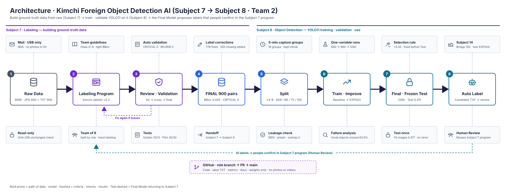
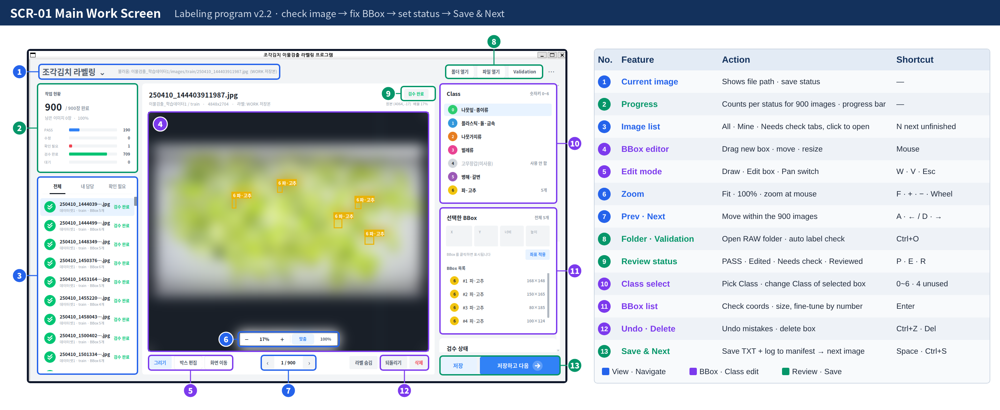

# group2-project — Kimchi Foreign Object Detection AI &nbsp;<sup><a href="README.md">한국어</a> | <b>English</b></sup>

<p align="center">
  
  
  
  
  
  
  <br>
  
  
  
  
  
  
</p>

## Project Overview

### Architecture

The original RAW data is read-only, and only the **FINAL 900 pairs** that pass every review step move on to Subject 8. Subject 8 splits the data by capture group, improves the model **one variable at a time** to choose the Final Model, and the candidate labels the Final Model produces are **confirmed by people in the Subject 7 program**.



<br>

### Summary

This is a Team 2 project on detecting foreign objects in cut kimchi. The original labels we were given had many mislabels and missing boxes, so they could not be used for training as-is. In **Subject 7** we built our own labeling program and reviewed all 900 images to create **ground-truth data (FINAL 900 pairs)**. In **Subject 8** we trained, improved and validated **YOLO11** on that data, then connected it back to the Subject 7 program through **Auto Label**.

The goal was **trustworthy data**, not a high score. Only labels that passed every review condition became FINAL, images from the same capture group were never split across training and evaluation, and the Final Model was fixed **before looking at the Frozen Test**.

<br>

### Results

| Area | Key result |
|---|---|
| Subject 7 · Labeling | **Full review** of 900 images · **778 images (86%)** corrected · 2,383 BBoxes fixed · 350 missing boxes added · CRITICAL **0** |
| Subject 7 · Criteria | Rubber gloves defined as **background** → only real foreign objects are detected · Class 0 ~ 6 (4 unused) |
| Subject 8 · Split | By 5-minute capture group · Train 609 · Val 66 · Test 75 · Bridge 150 · leakage 0 |
| Subject 8 · Model | Baseline mAP50-95 **0.345** → Final **EXP003 (yolo11n · 1280) 0.446 (+29%)** |
| Subject 8 · Validation | Frozen Test once · mAP50-95 **0.4115** |
| Subject 8 · Use | Final Model candidate labels → confirmed by **Human Review** in the Subject 7 program |

<br>

### Screen Design · Working Screen

This is **kimchi_labeler**, the labeling program we built in Subject 7. Candidate labels from the Subject 8 Final Model are also confirmed here through **Human Review**.



*Screen ID SCR-01 · numbers mark screen areas, and the table on the right lists each area's feature · action · shortcut. The program UI itself is in Korean. Original photos are blurred under the NDA.* How to use → [Subject 7 user manual (Korean)](project7/docs/04_user_manual.md)

<br>

### Team

| Name | Subject&nbsp;7 | Subject&nbsp;8 | Main role · deliverables |
|---|---|---|---|
| Sung&nbsp;Hyung&nbsp;Lee | PM | PM | Project lead · schedule · Class criteria · Split · evaluation criteria · Final Model decision · GitHub management · README · Architecture · presentation lead |
| Hasol&nbsp;Park | GUI | Experiment | Screen v01 → v02 · Figma · EXP001 ~ 004 · Final selection |
| Hana&nbsp;Park | Coord | Evaluation | Class · BBox guidelines · Golden Test · failure analysis · Frozen Test |
| Sangjik&nbsp;Lee | Storage | Training | Label saving · data merge · Smoke Test · Baseline training |
| Sehun&nbsp;Jang | QA | Data | Auto validation · Test Report · Dataset Audit · Split v4-B |
| Junhyung&nbsp;Kim | Manifest | Inference | Work manifest · QA Summary · Handoff · Detection · Auto Label |

<br>

### Quick Links

| Folder | What it is | Focus |
|---|---|---|
| [**project7**](project7/README.en.md) | **Subject 7 · Labeling** — the kimchi_labeler program, review of 900 images · FINAL data | Building ground-truth data · Tkinter program · Class · BBox guidelines |
| [**project8**](project8/README.en.md) | **Subject 8 · Object Detection** — YOLO11 training · failure analysis · improvement · Frozen Test · Auto Label | Building the model · Split · experiment log · Final Model |

<br><br>

## Quick Start

You need: a Windows 11 PC · an NVIDIA GPU for Subject 8 training · evaluation

**Step 1 · Install WSL (first time only)** — run PowerShell **as administrator**

```powershell
wsl --install
```

**Step 2 · Clone** — in the Ubuntu window

```bash
sudo apt update && sudo apt install -y git
git clone https://github.com/sunghyunglee6334-web/group2-project.git ~/group2_project
```

**Step 3 · Subject 7 labeling program** — install · test, then run with practice data

```bash
cd ~/group2_project/project7
bash setup_wsl.sh
bash run.sh --raw data/dummy_raw
```

**Step 4 · Subject 8 object detection** — after putting the FINAL 900 pairs (received by mail · USB) into `project8/data/final/`

```bash
cd ~/group2_project/project8
python3 -m venv .venv && source .venv/bin/activate
pip install -r requirements.txt pytest
python scripts/01_check_environment.py
python scripts/03_build_split.py
```

Trained weights come with the clone in `project8/models/`, so you can run evaluation · Detection right away without retraining. Detailed steps → [Subject 7 Quick Start](project7/README.en.md#quick-start) · [Subject 8 How to Run](project8/README.en.md#run)

<br><br>

## Notes

- **No original kimchi photos · result images showing photos · videos in Git** — label TXT · CSV · docs · training graphs are allowed
- The data is **100% synthetic** educational data from AI Campus and is **under NDA**.
- main changes only through PRs · no `git add .` · no `git add -f` (add by file name only)
