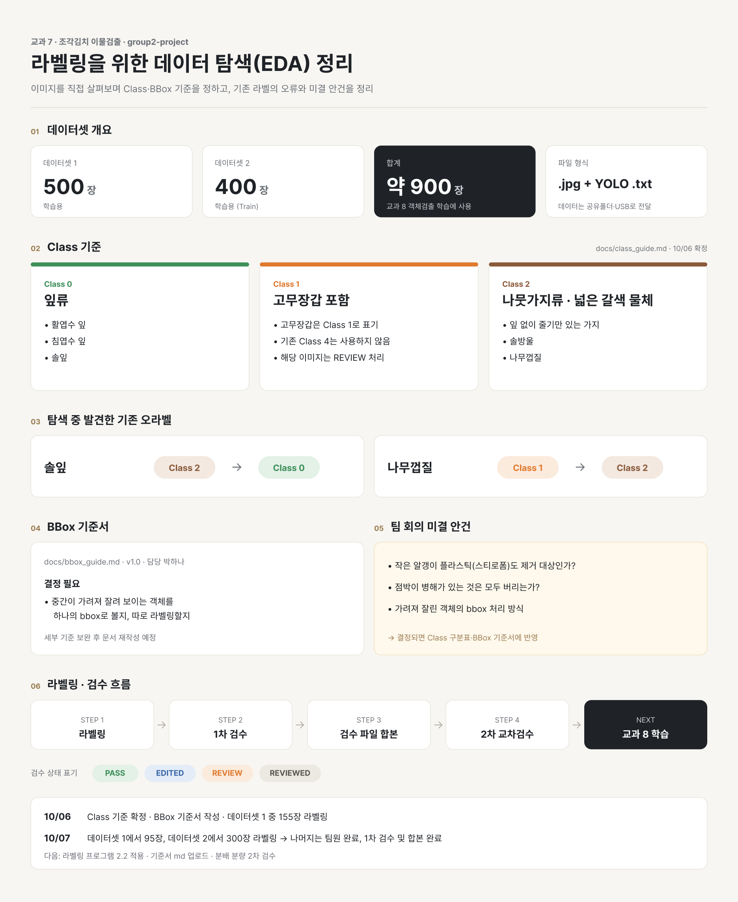
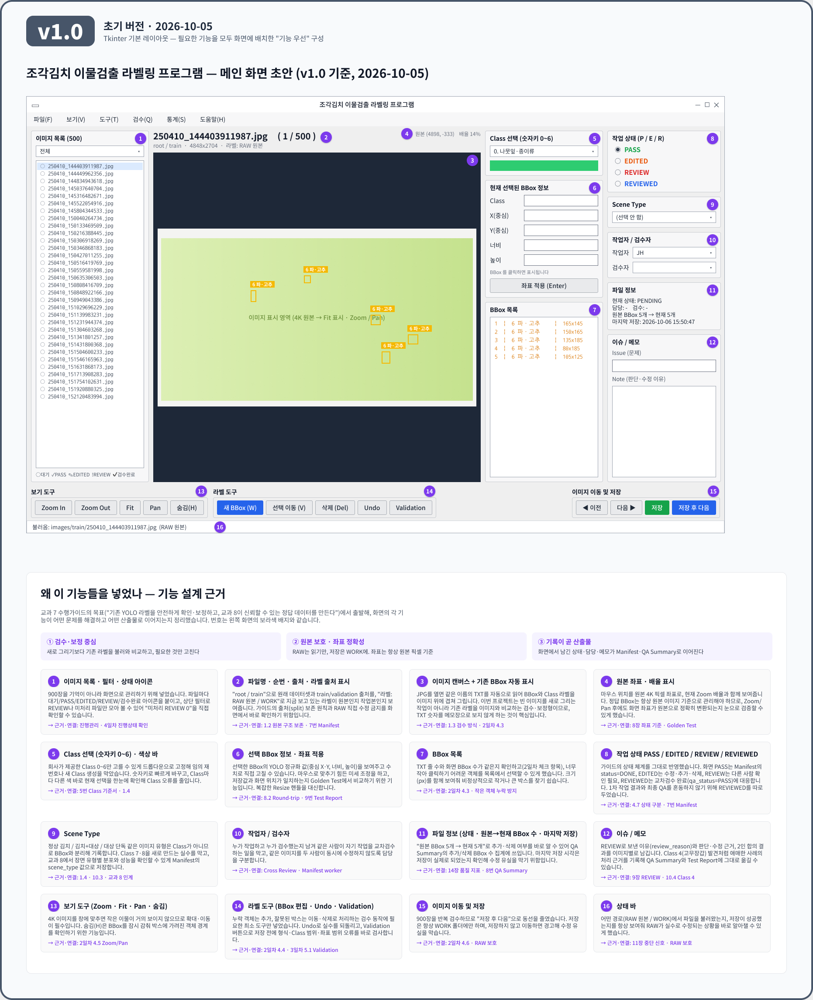
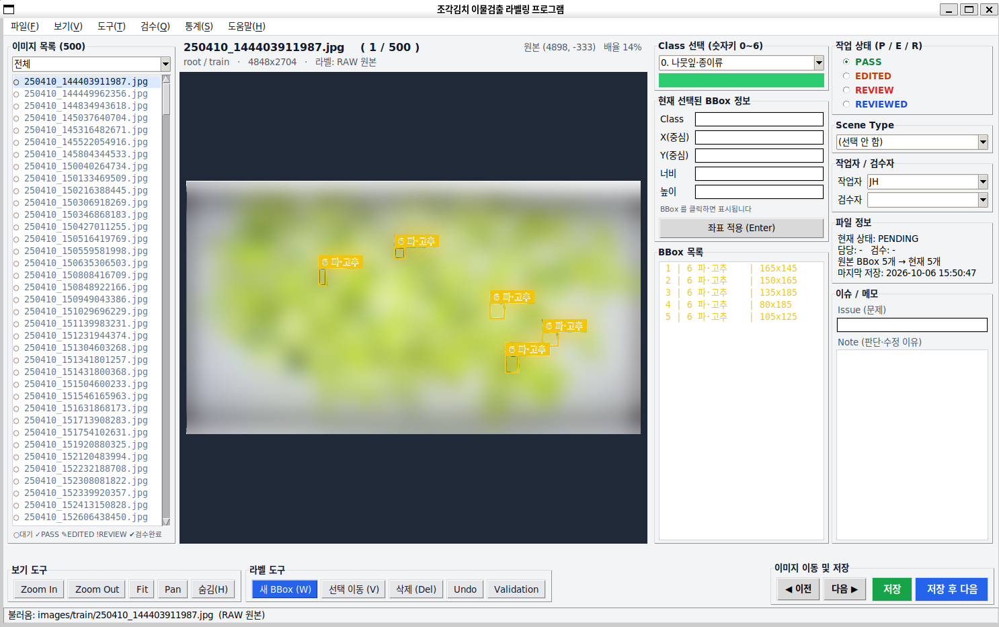
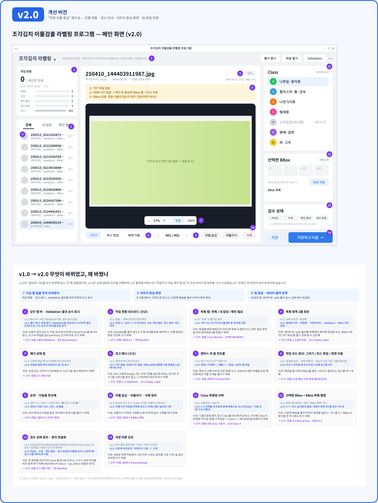
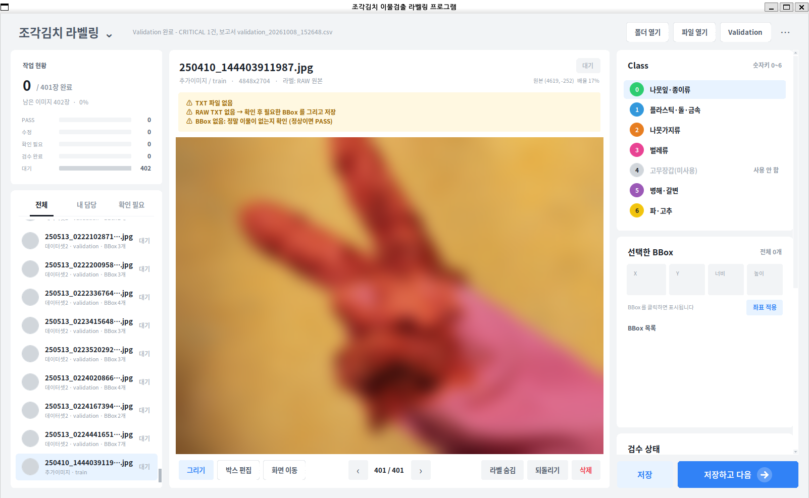

# 교과 7 Figma 보드 — 라벨링

팀 Figma 파일 **2조 · 교과7. UI** 페이지를 문서로 옮겼습니다. 데이터를 살펴보며 기준을 정하고, 라벨링 프로그램 화면을 v1.0 → v2.0 으로 바꾼 과정입니다.

- NDA 에 따라 **김치 사진은 블러 처리**했고, 라벨 박스 · Class 이름표는 그대로 보이게 두었습니다.
- 그림을 클릭하면 크게 볼 수 있습니다. · 교과 8 보드 → [project8_figma.md](project8_figma.md)

 

## 1. 라벨링을 위한 데이터 탐색 (EDA)

이미지를 직접 보며 Class · BBox 기준을 정하고, 기존 라벨의 오류와 미결 안건을 정리했습니다 (10/06 ~ 10/07).

*이때의 기준(고무장갑 = Class 1)은 이후 **고무장갑 = 배경**으로 바뀌었습니다 → [Class 기준서](../project7/docs/02_class_guide.md)*

 

## 2. 화면 v1.0 — 초기 버전 (10/05)

Tkinter 기본 레이아웃에 필요한 기능을 모두 배치한 "기능 우선" 구성입니다. 번호 1 ~ 16 은 화면 영역, 아래 카드는 기능마다 넣은 이유입니다.

**실제 v1.0 실행 화면** — 노란 박스 · 이름표는 기존 라벨(6 파·고추)이며 사진만 블러 처리했습니다.

 

## 3. 화면 v2.0 — 개선 버전

900장 검수에서 느낀 불편을 바탕으로 "작업자가 지금 해야 할 일"이 먼저 보이게 다시 구성했습니다. 번호 1 ~ 14 는 v1.0 → v2.0 변경점과 이유입니다.

**실제 v2.0 실행 화면** — 고무장갑 사진 예시 (블러 처리)

 

## 관련 문서

| 내용 | 문서 |
|---|---|
| 화면 영역별 기능 · 단축키 | [사용설명서 3장](../project7/docs/04_user_manual.md#3-사용-순서--화면--단축키) |
| 최종 화면 SCR-01 | [gui_main.png](../project7/docs/images/gui_main.png) |
| 버전별 변경 | [버전 기록](../project7/docs/06_version_history.md) |
