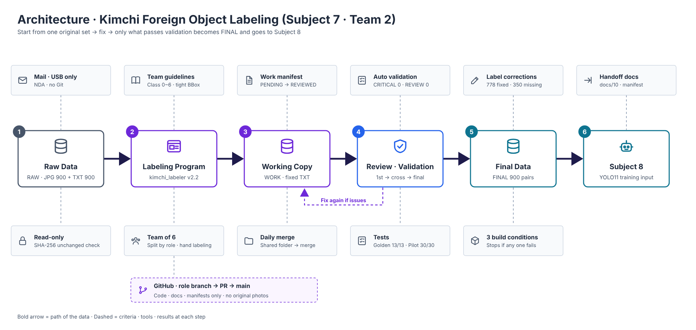
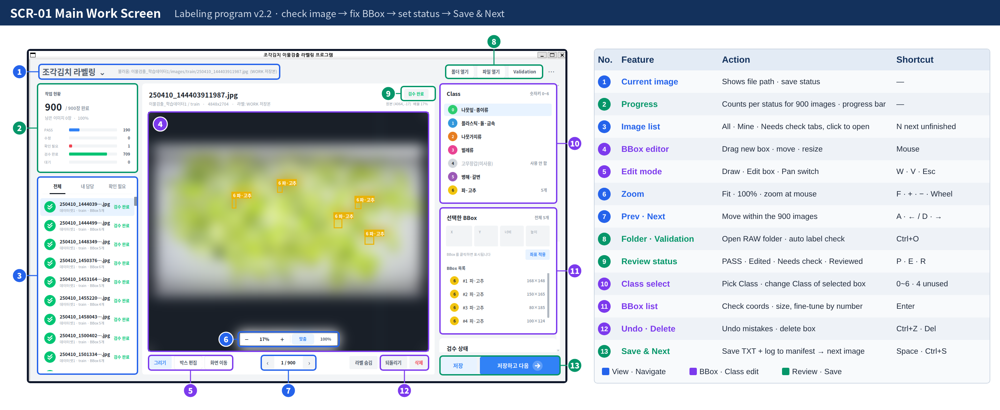
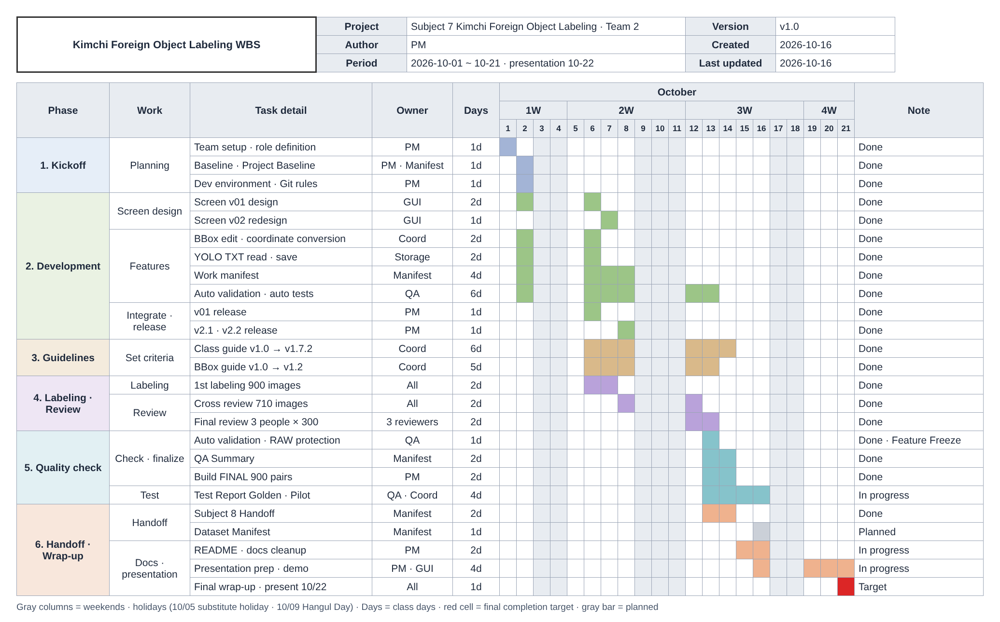

# Kimchi YOLO Labeling Tool

<p align="right"><a href="README.md">한국어</a> | <b>English</b></p>

## Project Overview

### Architecture

The original RAW data is read-only, and labels fixed in the program are saved only to the WORK copy. The FINAL 900 pairs are built and handed to Subject 8 **only when every review and auto-validation condition passes**.



Code · deliverables · owners per step · program internals → [00 Architecture (Korean)](docs/00_architecture.md)

<br>

### Summary

This is a Team 2 project on labeling foreign objects in cut kimchi. The provided dataset (900 4K JPGs + 900 YOLO TXTs, 4,399 existing BBoxes) contained mislabeled and missing labels. Training on it as-is would hurt model performance, so we built our own **labeling program that lets us check and fix each image**, and six team members reviewed the data against shared guidelines.

<br>

### Results

We **reviewed all 900 images**, with **0** auto-validation errors (CRITICAL). We fixed labels on **778 of 900 images (86%)**, **corrected 54% (2,383) of the original BBoxes**, and **added 350** missing foreign objects.

In particular, we **defined rubber gloves as background, the same as kimchi**, and removed every rubber glove box so that **the model detects only real foreign objects**.

**Why rubber gloves are background**

- **Class 4 is a numbered but unused Class** — rubber gloves were assigned to Class 4, but the instructor's guide marked it as "not used in this project," and the original labels had 0 Class 4 boxes.
- **Mislabeled as plastic in the original** — instead, rubber gloves had been boxed as Class 1 plastic · stone · metal, mixed in with real plastic objects.
- **Rubber gloves are process background, not foreign objects** — they are the workers' gloves and appear in almost every scene. If even one box remained, the model would learn gloves as foreign objects and flag normal work scenes as defects.
- **Decision** — draw no boxes and delete existing ones so gloves are learned as background (Class guide v1.7 · 10/12). Class number 4 is left empty to stay aligned with Subject 8 → [ISSUE-05 (Korean)](docs/05_issue_improvement.md#issue-05-고무장갑-class)

<br>

### Impact

As a result, we built the **FINAL dataset of 900 pairs** for Subject 8 training. Cleaning up mislabels such as rubber gloves reduced plastic · stone · metal (Class 1) from 1,831 to **1,665**, and disease · browning (Class 5), which had many missing boxes, grew from 313 to **465 (+49%)**.

| Key metric | Result |
|---|---|
| Review scope | **All 900** images · 1st labeling → cross review → final review |
| Classes | **6 kinds** of foreign objects detected out of **7 numbers (0~6)** · No. 4 rubber glove is background |
| Rubber gloves | **Background** together with kimchi · boxes deleted → only real foreign objects detected |
| Label corrections | **778 images** fixed · 2,383 boxes fixed · 350 missing objects added |
| Quality | Auto-validation CRITICAL **0** · remaining REVIEW **0** |

Evidence → [QA Summary (Korean)](reports/01_qa_summary.md)

<br>

### Screen Design · Working Screen



*Screen ID SCR-01 · numbers mark screen areas, and the table on the right lists each area's feature · action · shortcut. The program UI itself is in Korean. Original photos are blurred under the NDA, and the yellow boxes are real, reviewed BBoxes.*
All shortcuts · menus → [04 User Manual, Ch. 3 (Korean)](docs/04_user_manual.md#3-사용-순서--화면--단축키) · design history → [v01](docs/images/gui_v01.png) → [v02](docs/images/gui_v02.png)

<br>

### Team

| Role | Name | Responsibilities | Branch | Main deliverables |
|---|---|---|---|---|
| PM | Sung&nbsp;Hyung&nbsp;Lee | Project lead · schedule · task assignment · Class criteria decisions · GitHub management · FINAL build | feature/pm | README · Architecture · Baseline · User Manual · FINAL |
| GUI | Hasol&nbsp;Park | Program screen design · presentation captures · Figma | feature/gui | Screen v01 → v02 |
| Coord | Hana&nbsp;Park | BBox coordinates · Golden Test · guidelines | feature/coord | Class · BBox guidelines |
| Storage | Sangjik&nbsp;Lee | Label saving logic · data merge · release | feature/storage | Saving · merging |
| QA | Sehun&nbsp;Jang | Auto validation · RAW protection · tests | feature/qa | Validation · Test Report |
| Manifest | Junhyung&nbsp;Kim | Work manifest · records · handoff · minutes | feature/manifest | Manifest · QA Summary · Handoff |

<br>

### Quick Links

| Purpose | Link |
|---|---|
| First run | [Quick Start](#quick-start) → [4. Basic Workflow](#usage) |
| Results · evidence | [Impact](#impact) · [10. QA · Test Results](#qa) · [13. Deliverables](#deliverables) |
| Criteria · docs | [2. Folder Structure · Doc Map](#folders) · [12. WBS Schedule](#team) |
| Troubleshooting | [14. Notes](#caution) |

<br><br>

## Quick Start

You need: one Windows 11 PC. Skip step 1 if WSL is already installed.

**Step 1 · Install WSL (first time only)** — from the Start menu, run PowerShell **as administrator**

```powershell
wsl --install
```

After rebooting, set a user name and password in the Ubuntu window that opens.

**Step 2 · Clone · install** — run line by line in the Ubuntu window · enter the step 1 password when asked

```bash
sudo apt update && sudo apt install -y git
git clone https://github.com/sunghyunglee6334-web/group2-project.git ~/group2_project
cd ~/group2_project/project7
bash setup_wsl.sh
```

`setup_wsl.sh` installs Python · Korean fonts · a virtual environment · practice data and runs the automated tests in one go. It is done when you see `모든 테스트 통과 (4개)` (all 4 tests passed).

**Step 3 · Run** — the program window opens with practice data.

```bash
bash run.sh --raw data/dummy_raw
```

<br><br>

<a id="features"></a>
<details>
<summary><b>1. Main Features</b> — open images · edit BBoxes · change Class · Zoom · status management · save · Validation</summary>

Numbers refer to the area numbers on the [working screen](#screen-design--working-screen).

| Feature | Screen no. |
|---|---|
| Open JPG images · folders | 1 · 8 |
| Auto-load existing YOLO TXT · show BBoxes and Classes | 4 · 11 |
| Add / edit / delete BBoxes · undo | 4 · 5 · 12 |
| Change Class · number keys 0~6 | 10 |
| Previous / next image | 7 |
| Zoom / Pan on 4K images | 6 |
| Status: PASS · Edited · Needs check · Reviewed | 9 |
| Save · reload YOLO TXT — Save & Next | 13 |
| Validation — automatic label format check | 8 |
| Progress · image list filters | 2 · 3 |
| Extras: built-in Korean input · automatic manifest logging · safe saving · operation scripts 00~10 | — |

</details>

<a id="folders"></a>
<details>
<summary><b>2. Folder Structure</b> — program code · settings · scripts · tests · doc map · data location</summary>

```text
project7/
│
├── main.py                    ← program entry point
├── run.sh · setup_wsl.sh      ← run · install
├── requirements.txt           ← runtime packages
├── README.md                  ← project guide
│
├── src/                       ← labeling program code
│   ├── ui/                    ← screens · menus
│   ├── bbox/                  ← BBox editing · save rules
│   ├── yolo/                  ← YOLO TXT read · write
│   ├── validation/            ← automatic label checks
│   └── manifest.py            ← work manifest logging
│
├── configs/
│   └── classes.yaml           ← Class 0~6 settings
│
├── scripts/                   ← assign → merge → check → FINAL → handoff
├── tests/                     ← automated tests
│
├── docs/                      ← guidelines · manuals · records (doc map below)
├── manifests/                 ← work manifests
├── reports/                   ← QA Summary · Test Report
│
└── data/                      ← real data · not in Git
    ├── raw/                   ← originals · read-only
    ├── work_raw/              ← working copy
    └── final/                 ← FINAL 900 pairs · Subject 8 input
```

Role of each file · code flow → [09 Code Study 0.2 File Map (Korean)](docs/09_code_study.md#02-파일-지도와-역할-담당)

#### Doc Map

Doc numbers are the reading order. The documents are written in Korean.

| What you want to know | Document | Owner · updated |
|---|---|---|
| Overall structure · data flow | [00 Architecture](docs/00_architecture.md) | PM · 10/19 |
| Criteria · completion conditions | [01 Project Baseline](docs/01_project_baseline.md) | PM · Manifest · 10/15 |
| Which Class to label | [02 Class Guide](docs/02_class_guide.md) v1.7.2 | Coord · 10/14 |
| How far to draw a box | [03 BBox Guide](docs/03_bbox_guide.md) v1.2 | Coord · 10/13 |
| Install · run · shortcuts · troubleshooting | [04 User Manual](docs/04_user_manual.md) | PM · 10/15 |
| What went wrong and how we fixed it | [05 Issues → Improvements](docs/05_issue_improvement.md) | PM · 10/15 |
| What changed and when | [06 Version History](docs/06_version_history.md) | PM · 10/15 |
| Team work by date | [07 Team Work Log](docs/07_team_worklog.md) | Manifest · 10/15 |
| How the code works | [08 Code Review](docs/08_code_review.md) → [09 Code Study](docs/09_code_study.md) | PM · 10/15 |
| What we handed to Subject 8 | [10 Subject 8 Handoff](docs/10_subject08_handoff.md) | Manifest · 10/14 |
| Review results · test results | [01 QA Summary](reports/01_qa_summary.md) · [02 Test Report](reports/02_test_report.md) | Manifest · QA |

</details>

<a id="install"></a>
<details>
<summary><b>3. Install · Run</b> — install · worker name · RAW folder · update</summary>

- The install commands are the same as in [Quick Start](#quick-start).
- On first run, enter your **worker name** once, then use **Open Folder** to pick the original RAW folder (the one that directly contains 학습데이터1 · 2).
- The real data is under NDA and not in Git. Put `이물검출_학습데이터1` · `이물검출_학습데이터2` (received by mail · USB) into `data/raw/` and run `bash run.sh --raw data/raw`.
- Update → [1-2. Update to a new version (Korean)](docs/04_user_manual.md#1-2-새-버전으로-업데이트) · install problems → [8. Troubleshooting (Korean)](docs/04_user_manual.md#8-문제-해결)

</details>

<a id="usage"></a>
<details>
<summary><b>4. Basic Workflow</b> — open folder → check → fix → REVIEW → Save & Next → Validation</summary>

1. After **Open Folder**, choose **Mine** in the list on the left.
2. Check the automatically loaded BBoxes and Classes.
3. Fix wrong BBoxes, add missing objects, and delete mislabels.
4. If you can't decide, save as **Needs check (REVIEW)** and write the reason in the note.
5. **Save & Next (Space)** — saves the TXT and logs to the work manifest at the same time.
6. At the end of the day, run **Validation** and send the working copy to Storage.

Screens · shortcuts → [04 User Manual, Ch. 3 (Korean)](docs/04_user_manual.md#3-사용-순서--화면--단축키) · save rules → [Ch. 4](docs/04_user_manual.md#4-저장-규칙)

</details>

<a id="label-format"></a>
<details>
<summary><b>5. YOLO Label Format</b> — Class · center x · y · width · height · 0~1 ratio · empty TXT</summary>

- One TXT line = one object: **Class number · center x · center y · width · height**, as a **0~1 ratio** of the image · 6 decimal places
- Example: `6 0.800620 0.623148 0.034091 0.053704` → one Class 6 green onion · pepper box
- Images with no foreign objects still get an **empty TXT** (26 images) · images whose labels were not changed keep the original TXT **byte for byte**

</details>

<a id="classes"></a>
<details>
<summary><b>6. Class Settings</b> — Class 0~6 · BBox 4,399 → 4,405 · rubber gloves as background</summary>

Settings `configs/classes.yaml` · criteria [02 Class Guide (Korean)](docs/02_class_guide.md) v1.7.2 · when confused → [Class comparison table (Korean)](docs/02_class_guide.md#헷갈리기-쉬운-class-구분표)

| Class | Name | Original BBox | Final BBox | Change |
|---:|---|---:|---:|---:|
| 0 | Leaves · paper | 716 | 709 | −7 |
| 1 | Plastic · stone · metal | 1,831 | 1,665 | −166 |
| 2 | Twigs | 911 | 937 | +26 |
| 3 | Insects | 379 | 378 | −1 |
| 4 | Rubber glove — unused · background | 0 | 0 | 0 |
| 5 | Disease · browning | 313 | 465 | **+152** |
| 6 | Green onion · pepper | 249 | 251 | +2 |
| | Total | 4,399 | 4,405 | +6 |

- **Kimchi · rubber gloves = background**; no boxes are drawn. Class number 4 is left empty to stay aligned with Subject 8.
- If an object is clearly foreign even when small, draw a box + note `small` → [Small object rule (Korean)](docs/02_class_guide.md#작은-이물-처리-기준)

</details>

<a id="bbox"></a>
<details>
<summary><b>7. BBox Rules</b> — tight to the outline · one box per object · 2,014 position · size fixes</summary>

- Criteria [03 BBox Guide (Korean)](docs/03_bbox_guide.md) v1.2 · good vs. bad examples → [team example images](docs/03_bbox_guide.md#11-팀-예시-이미지)
- **Tight to the object's outline**, within 3px of margin · never cut off the object
- **One object = one box** · at the image edge, box only the visible part · if unsure, REVIEW
- Under these rules, **2,014** positions · sizes were fixed, 1,857 of them fine adjustments within 10px

</details>

<a id="data"></a>
<details>
<summary><b>8. Data Locations</b> — RAW · WORK · FINAL · in Git or not</summary>

| Stage | Location | Contents | Git |
|---|---|---|---|
| Original RAW | `data/raw/` | Dataset 1 train 500 · Dataset 2 train 220 · validation 180 | Excluded |
| Working copy WORK | `data/work_raw/` | Fixed TXTs + work manifest | Excluded |
| Final FINAL | `data/final/` | 900 images · 900 labels + final manifest | Labels only |

- **RAW is only opened, never changed** — verified with hashes
- Scene types: kimchi + foreign objects 725 · foreign objects only 149 · normal kimchi 24 · neither kimchi nor objects 2

</details>

<a id="status"></a>
<details>
<summary><b>9. Work Status</b> — PENDING · PASS · EDITED · REVIEW · REVIEWED · 3 review stages</summary>

Every image's status is logged automatically in the work manifest. Copy: [manifests/manifest_final.csv](manifests/manifest_final.csv)

| Status | Meaning |
|---|---|
| PENDING | Not looked at yet |
| PASS | Checked, no changes |
| EDITED | Fixed and saved → cross-reviewed by someone else |
| REVIEW | Hard to judge → decided by PM + QA |
| REVIEWED | Cross · final review done → goes into FINAL |

Review stages: 1st labeling of 900 images → cross review of 710 → final review by 3 people × 300 images, excluding images they had seen before → **all REVIEWED**

</details>

<a id="qa"></a>
<details>
<summary><b>10. QA · Test Results</b> — CRITICAL 0 · REVIEW 0 · Golden 13/13 · Pilot 30/30</summary>

- **QA** — 900 images · 900 TXTs · CRITICAL **0** · final REVIEW **0** → [01 QA Summary (Korean)](reports/01_qa_summary.md) · [validation result file](reports/03_validation_final.csv)
- **Error found by people** — 2 of the 26 empty labels were images with only rubber gloves → added scene type `none` → [ISSUE-08 (Korean)](docs/05_issue_improvement.md#issue-08-배경만-있는-사진-2장)
- **Program tests** — all **8** development bugs fixed · retest PASS · **4** automated tests passed → [02 Test Report (Korean)](reports/02_test_report.md)
- **Golden → Pilot → Final Acceptance** — Golden 13 / 13 PASS · Pilot 30 / 30 PASS · final verdict on 900 images ACCEPTED → [Golden Test (Korean)](reports/02_test_report.md#1-golden-test)

</details>

<a id="final"></a>
<details>
<summary><b>11. FINAL Dataset</b> — 900 pairs · build conditions · Subject 8 input</summary>

- `data/final/images/` 900 images · `data/final/labels/` 900 files, paired by file name + final manifest
- Built only when REVIEW 0 · CRITICAL 0 · never edited directly; fix in WORK and rebuild
- Handed over as the training input for Subject 8 YOLO11n → [10 Subject 8 Handoff (Korean)](docs/10_subject08_handoff.md)

</details>

<a id="team"></a>
<details>
<summary><b>12. Team Operation</b> — WBS schedule</summary>

#### WBS Schedule

We broke the project scope into phase → work → task detail, assigned an owner · duration to each task, and managed it as a schedule.



Actual work by date → [07 Team Work Log (Korean)](docs/07_team_worklog.md) · changes by version → [06 Version History (Korean)](docs/06_version_history.md)

</details>

<a id="deliverables"></a>
<details>
<summary><b>13. Deliverables · Version Control</b> — 11 required · 7 extra · versions · 11 issues</summary>

#### Required Deliverables

| No. | 11 required by the instructor | Location | Status |
|---:|---|---|---|
| 1 | Labeling program | `main.py` · `src/` | Done · v2.2 |
| 2 | Source code · runtime environment | `src/` · `requirements.txt` · `configs/` | Done |
| 3 | FINAL YOLO labels | `data/final/` | Done · 900 pairs |
| 4 | Project Baseline | [docs/01](docs/01_project_baseline.md) | Done |
| 5 | Class guide | [docs/02](docs/02_class_guide.md) | Done · v1.7.2 |
| 6 | BBox guide | [docs/03](docs/03_bbox_guide.md) | Done · v1.2 |
| 7 | Dataset Manifest | `manifests/dataset_manifest.csv` | Planned · after FINAL |
| 8 | QA Summary | [reports/01](reports/01_qa_summary.md) | Done |
| 9 | Test Report | [reports/02](reports/02_test_report.md) | Done · Golden 13 / 13 · Pilot 30 / 30 |
| 10 | README | This document | Done |
| 11 | Subject 8 Handoff | [docs/10](docs/10_subject08_handoff.md) | Done |

#### Extra Deliverables

| Extra deliverable | Location | Why we added it |
|---|---|---|
| Architecture | [docs/00](docs/00_architecture.md) | Explains the 6-step data flow · program structure · design principles on one page |
| User Manual | [docs/04](docs/04_user_manual.md) | So first-time users can follow install · run · troubleshooting |
| Issue → improvement report | [docs/05](docs/05_issue_improvement.md) | Records how issues were found · their causes · fixes |
| Version history | [docs/06](docs/06_version_history.md) | Tracks changes to the program · guidelines · data |
| Team work log | [docs/07](docs/07_team_worklog.md) | Work by date · minutes |
| Code review · code study | [docs/08](docs/08_code_review.md) · [docs/09](docs/09_code_study.md) | So every team member can explain the code |
| Validation results · manifest copy | [reports/03](reports/03_validation_final.csv) · [manifest_final.csv](manifests/manifest_final.csv) | Proves CRITICAL 0 · the full status as files |

#### Versions · Issues

- Current versions: program **v2.2** · Class guide **v1.7.2** · BBox guide **v1.2** · data **FINAL 900** → [06 Version History (Korean)](docs/06_version_history.md)
- **All 11 issues resolved** + 4 enhancements → [05 Issues → Improvements (Korean)](docs/05_issue_improvement.md)
- Biggest issue: every correction count in the QA Summary was 0 → not a bug but a comparison path problem → fixed by specifying the original · working copy paths directly → [ISSUE-07 (Korean)](docs/05_issue_improvement.md#issue-07-qa-summary-보정-숫자-0건)

</details>

<a id="caution"></a>
<details>
<summary><b>14. Notes</b> — no original photos in Git · NDA · keep RAW intact · docs by problem type</summary>

- **No original kimchi photos on GitHub · messengers · personal cloud**, mail · USB only · label TXT · CSV are allowed in Git (confirmed by the instructor, 10/13)
- The data is **100% synthetic** educational data from AI Campus and is **under NDA**.
- Never modify RAW, and never put REVIEW items into FINAL.
- Image and TXT file names must match.
- Before submitting, check save · reload, then run Validation.
- main changes only through PRs · no `git add .`

#### Docs by Problem Type

| Problem | Where to look (Korean) |
|---|---|
| Install · run fails | [04 User Manual 8. Troubleshooting](docs/04_user_manual.md#8-문제-해결) |
| Save fails · BBox looks wrong | [04 User Manual 4. Save Rules](docs/04_user_manual.md#4-저장-규칙) → [08 Code Review A1](docs/08_code_review.md#a1-srcbboxsessionpy--저장-규칙) |
| Validation reports CRITICAL | [Validation results](reports/03_validation_final.csv) → [02 Class Guide](docs/02_class_guide.md) |
| QA Summary correction count is 0 | [05 ISSUE-07](docs/05_issue_improvement.md#issue-07-qa-summary-보정-숫자-0건) |
| Unsure which Class | [02 Class comparison table](docs/02_class_guide.md#헷갈리기-쉬운-class-구분표) |

</details>
