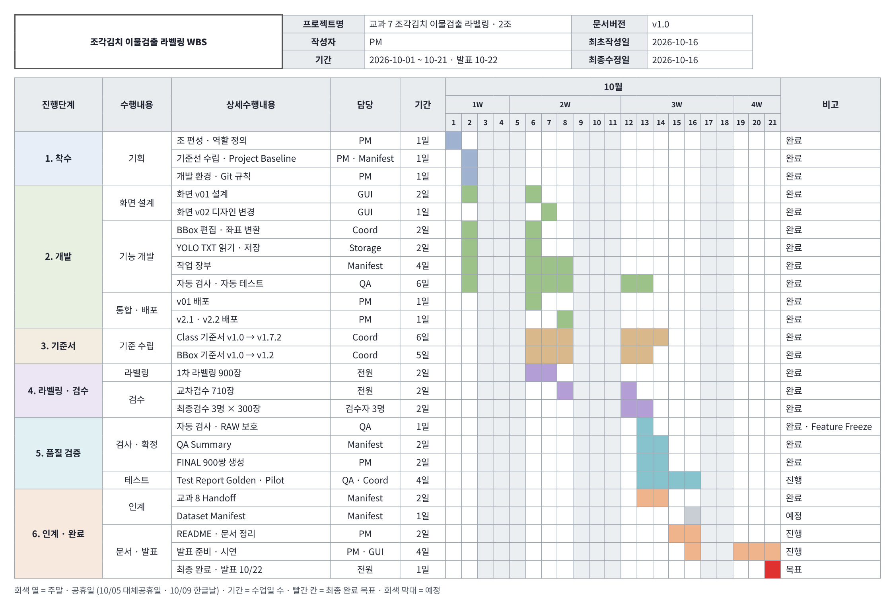

# Kimchi YOLO Labeling Tool

## 1. 프로젝트 소개

### 개요

조각김치 이물검출 라벨링 · 2조 프로젝트입니다. 제공된 조각김치 이물검출 데이터(4K JPG 900장 + YOLO TXT 900개, 기존 BBox 4,399개)에는 오표기 · 누락 라벨이 포함되어 있었습니다. 이를 그대로 학습하면 모델 성능이 저하되므로, **이미지 단위 확인 · 수정이 가능한 라벨링 프로그램**을 자체 개발하고 6명이 공통 기준서에 따라 검수했습니다.

<br>

### 작업 결과

900장 **전수 검수**를 완료했으며, 자동 검사 오류(CRITICAL)는 **0건**입니다. 900장 중 **778장(86%)** 의 라벨을 고쳤고, 원본 BBox 의 **54%(2,383개)를 수정**했으며 누락된 이물 **350개를 추가**했습니다.

특히 **고무장갑을 김치와 같은 배경으로 정의**하고 고무장갑 박스를 모두 삭제해, **모델이 실제 이물만 검출**하도록 기준을 세웠습니다.

**고무장갑을 배경으로 정한 이유**

- **Class 4 는 번호만 있는 미사용 Class** — 고무장갑은 Class 4 로 배정되어 있지만 강사님 수행가이드에서 '이번 프로젝트에서 사용하지 않는 항목' 으로 정해졌고, 원본 라벨에도 Class 4 는 0건이었습니다.
- **원본에서는 플라스틱 이물로 잘못 표기** — 대신 고무장갑이 Class 1 플라스틱 · 돌 · 금속 박스로 들어가 있어, 실제 플라스틱 이물과 섞여 있었습니다.
- **고무장갑은 이물이 아니라 공정 배경** — 작업자가 쓰는 장갑으로 촬영 장면에 늘 함께 나옵니다. 박스가 하나라도 남으면 모델이 고무장갑을 이물로 배워 정상 작업 장면까지 불량으로 판정합니다.
- **결정** — 박스를 그리지 않고 기존 박스는 삭제해 배경으로 학습시킵니다 (Class 기준서 v1.7 · 10/12). Class 4 번호는 교과 8 과 맞추려고 비워 둡니다 → [ISSUE-05](docs/05_issue_improvement.md#issue-05-고무장갑-class)

<br>

### 개선 효과

그 결과 교과 8 학습용 **FINAL 데이터 900쌍**을 구축했습니다. 고무장갑 등 오표기 정리로 플라스틱 · 돌 · 금속(Class 1)은 1,831 → **1,665개**로 줄었고, 누락이 많던 병해 · 갈변(Class 5)은 313 → **465개(+49%)** 로 보완되었습니다.

| 핵심 지표 | 결과 |
|---|---|
| 검수 범위 | 이미지 **900장 전수** · 1차 라벨링 → 교차검수 → 최종검수 |
| Class 구성 | 번호 **7개(0~6)** 중 이물 **6종** 검출 · 4번 고무장갑은 배경 |
| 고무장갑 처리 | 김치와 함께 **배경** · 박스 삭제 → 실제 이물만 검출 |
| 라벨 보정 | **778장** 수정 · 박스 2,383개 수정 · 누락 이물 350개 추가 |
| 품질 | 자동 검사 CRITICAL **0** · 남은 REVIEW **0** |

근거 → [QA Summary](reports/01_qa_summary.md)

<br>

### 화면 설계 · 작동 화면


*화면 ID SCR-01 · 번호는 화면 영역, 오른쪽 표는 영역별 기능 · 동작 · 단축키입니다. NDA 에 따라 원본 사진은 블러 처리했으며, 노란 박스는 검수 완료된 실제 BBox 입니다.*
전체 단축키 · 메뉴 → [04 사용설명서 3장](docs/04_user_manual.md#3-사용-순서--화면--단축키) · 디자인 변천 → [v01](docs/images/gui_v01.png) → [v02](docs/images/gui_v02.png)

<br>

### Architecture

> 준비 중 — 여기에 Architecture 그림과 설명이 들어갑니다 (`docs/00_architecture.md`).

데이터 처리 흐름: **원본 RAW(읽기만) → 작업본 WORK(프로그램이 저장) → 합치기 · 검수 → FINAL(교과 8 입력)**

<br>

### 팀원 소개

| 직책 | 역할 | 브랜치 | 주요 산출물 |
|---|---|---|---|
| PM | 일정 · 작업 배분 · GitHub 관리 · FINAL 생성 | feature/pm | README · Baseline · 사용설명서 · FINAL |
| GUI | 프로그램 화면 디자인 · 발표 캡처 · Figma | feature/gui | 화면 v01 → v02 |
| Coord | BBox 좌표 · Golden Test · 기준서 | feature/coord | Class · BBox 기준서 |
| Storage | 라벨 저장 로직 · 데이터 취합 · 배포 | feature/storage | 저장 · 합치기 |
| QA | 자동 검사 · RAW 보호 · 테스트 | feature/qa | Validation · Test Report |
| Manifest | 작업 장부 · 기록 · 인계 · 서기 | feature/manifest | Manifest · QA Summary · Handoff |

<br>

### 바로가기

| 용도 | 바로가기 |
|---|---|
| 처음 실행 | [빠른 시작](#빠른-시작) → [5. 기본 사용 순서](#5-기본-사용-순서) |
| 성과 · 근거 | [개선 효과](#개선-효과) · [11. QA · 테스트 결과](#11-qa--테스트-결과) · [14. 산출물](#14-산출물--버전-관리) |
| 기준 · 문서 | [3. 폴더 구조 · 문서 지도](#3-프로젝트-폴더-구조) · [13. WBS 일정](#wbs-일정) |
| 문제 대응 | [15. 주의사항](#15-주의사항) |

<br><br>

## 빠른 시작

준비물: Windows 11 PC 한 대. WSL 이 이미 있으면 1단계는 건너뜁니다.

**1단계 · WSL 설치 (처음 한 번)** — 시작 메뉴에서 PowerShell 을 **관리자 권한으로 실행**

```powershell
wsl --install
```

재부팅 후 열리는 Ubuntu 창에서 사용자 이름과 비밀번호를 정합니다.

**2단계 · 받기 · 설치** — Ubuntu 창에서 한 줄씩 실행 · 비밀번호를 물으면 1단계 비밀번호 입력

```bash
sudo apt update && sudo apt install -y git
git clone https://github.com/sunghyunglee6334-web/group2-project.git ~/group2_project
cd ~/group2_project/project7
bash setup_wsl.sh
```

`setup_wsl.sh` 가 Python · 한글 글꼴 · 가상환경 · 연습 데이터 설치와 자동 테스트까지 한 번에 합니다. `모든 테스트 통과 (4개)` 가 나오면 완료입니다.

**3단계 · 실행** — 연습 데이터로 프로그램 창이 열립니다.

```bash
bash run.sh --raw data/dummy_raw
```

<br><br>

## 2. 프로젝트 주요 기능

번호는 [작동 화면](#화면-설계--작동-화면)의 영역 번호입니다.

| 기능 | 화면 번호 |
|---|---|
| JPG 이미지 · 폴더 열기 | 1 · 8 |
| 기존 YOLO TXT 자동 Load · BBox 와 Class 표시 | 4 · 11 |
| BBox 추가 / 수정 / 삭제 · 되돌리기 | 4 · 5 · 12 |
| Class 변경 · 숫자키 0~6 | 10 |
| 이전 / 다음 이미지 이동 | 7 |
| 4K 이미지 Zoom / Pan | 6 |
| 상태 관리 PASS · 수정 · 확인 필요 · 검수 완료 | 9 |
| YOLO TXT 저장 · Reload — 저장하고 다음 | 13 |
| Validation — 라벨 형식 자동 검사 | 8 |
| 작업 현황 · 사진 목록 필터 | 2 · 3 |
| 추가 기능: 내장 한글 입력기 · 작업 장부 자동 기록 · 안전 저장 · 운영 스크립트 00~10 | — |

<br><br>

## 3. 프로젝트 폴더 구조

```text
project7/
│
├── main.py                    ← 프로그램 시작
├── run.sh · setup_wsl.sh      ← 실행 · 설치
├── requirements.txt           ← 실행 환경 패키지
├── README.md                  ← 프로젝트 안내
│
├── src/                       ← 라벨링 프로그램 코드
│   ├── ui/                    ← 화면 · 메뉴
│   ├── bbox/                  ← BBox 편집 · 저장 규칙
│   ├── yolo/                  ← YOLO TXT 읽기 · 쓰기
│   ├── validation/            ← 라벨 자동 검사
│   └── manifest.py            ← 작업 장부 기록
│
├── configs/
│   └── classes.yaml           ← Class 0~6 설정
│
├── scripts/                   ← 배정 → 합치기 → 검사 → FINAL → 인계
├── tests/                     ← 자동 테스트
│
├── docs/                      ← 기준서 · 설명서 · 기록 (아래 문서 지도)
├── manifests/                 ← 작업 장부
├── reports/                   ← QA Summary · Test Report
│
└── data/                      ← 실제 데이터 · Git 제외
    ├── raw/                   ← 원본 · 읽기만
    ├── work_raw/              ← 작업본
    └── final/                 ← FINAL 900쌍 · 교과 8 입력
```

파일별 역할 · 코드 흐름 → [09 코드 공부 0.2 파일 지도](docs/09_code_study.md#02-파일-지도와-역할-담당)

### 문서 지도

문서 번호는 읽는 순서입니다.

| 알고 싶은 것 | 문서 | 담당 · 수정일 |
|---|---|---|
| 기준 · 완료 조건 | [01 Project Baseline](docs/01_project_baseline.md) | PM · Manifest · 10/15 |
| 어떤 Class 로 라벨할지 | [02 Class 기준서](docs/02_class_guide.md) v1.7.2 | Coord · 10/14 |
| 박스를 어디까지 그릴지 | [03 BBox 기준서](docs/03_bbox_guide.md) v1.2 | Coord · 10/13 |
| 설치 · 실행 · 단축키 · 문제 해결 | [04 사용설명서](docs/04_user_manual.md) | PM · 10/15 |
| 어떤 문제가 있었고 어떻게 고쳤나 | [05 이슈 → 개선](docs/05_issue_improvement.md) | PM · 10/15 |
| 언제 무엇이 바뀌었나 | [06 버전 기록](docs/06_version_history.md) | PM · 10/15 |
| 날짜별 팀 작업 | [07 팀 작업 기록](docs/07_team_worklog.md) | Manifest · 10/15 |
| 코드가 어떻게 동작하나 | [08 코드 리뷰](docs/08_code_review.md) → [09 코드 공부](docs/09_code_study.md) | PM · 10/15 |
| 교과 8 에 무엇을 넘겼나 | [10 교과 8 Handoff](docs/10_subject08_handoff.md) | Manifest · 10/14 |
| 검수 결과 · 테스트 결과 | [01 QA Summary](reports/01_qa_summary.md) · [02 Test Report](reports/02_test_report.md) | Manifest · QA |

<br><br>

## 4. 설치 · 실행

- 설치 명령은 [빠른 시작](#빠른-시작) 과 같습니다.
- 처음 실행하면 **작업자 이름**을 한 번 입력하고, **폴더 열기**로 원본 RAW 폴더(학습데이터1 · 2 가 바로 안에 있는 폴더)를 고릅니다.
- 실제 데이터는 NDA 대상이라 Git 에 없습니다. 메일 · USB 로 받은 `이물검출_학습데이터1` · `이물검출_학습데이터2` 를 `data/raw/` 에 넣고 `bash run.sh --raw data/raw` 로 실행합니다.
- 업데이트 → [1-2. 새 버전으로 업데이트](docs/04_user_manual.md#1-2-새-버전으로-업데이트) · 설치 문제 → [8. 문제 해결](docs/04_user_manual.md#8-문제-해결)

<br><br>

## 5. 기본 사용 순서

1. **폴더 열기** 후 왼쪽 목록에서 **내 담당** 을 고릅니다.
2. 자동으로 Load 된 기존 BBox 와 Class 를 확인합니다.
3. 잘못된 BBox 는 수정, 누락된 이물은 추가, 오표기는 삭제합니다.
4. 판단이 어려우면 **확인 필요(REVIEW)** 로 저장하고 노트에 이유를 적습니다.
5. **저장하고 다음 (Space)** — TXT 저장과 작업 장부 기록이 같이 됩니다.
6. 하루 마감에 **Validation** 을 실행하고 작업본을 Storage 에게 보냅니다.

화면 · 단축키 → [04 사용설명서 3장](docs/04_user_manual.md#3-사용-순서--화면--단축키) · 저장 규칙 → [4장](docs/04_user_manual.md#4-저장-규칙)

<br><br>

## 6. YOLO Label 형식

- TXT 한 줄 = 객체 하나: **Class 번호 · 중심 x · 중심 y · 너비 · 높이**, 이미지 대비 **0~1 비율** · 소수점 6자리
- 예: `6 0.800620 0.623148 0.034091 0.053704` → Class 6 파 · 고추 박스 하나
- 이물이 없는 사진도 **빈 TXT** 를 둡니다 (26장) · 라벨을 안 바꾼 사진은 원본 TXT 를 **바이트 그대로** 저장

<br><br>

## 7. Class 설정

설정 `configs/classes.yaml` · 판단 기준 [02 Class 기준서](docs/02_class_guide.md) v1.7.2 · 헷갈릴 때 → [Class 구분표](docs/02_class_guide.md#헷갈리기-쉬운-class-구분표)

| Class | 이름 | 원본 BBox | 최종 BBox | 변화 |
|---:|---|---:|---:|---:|
| 0 | 나뭇잎 · 종이류 | 716 | 709 | −7 |
| 1 | 플라스틱 · 돌 · 금속 | 1,831 | 1,665 | −166 |
| 2 | 나뭇가지류 | 911 | 937 | +26 |
| 3 | 벌레류 | 379 | 378 | −1 |
| 4 | 고무장갑 — 사용 안 함 · 배경 | 0 | 0 | 0 |
| 5 | 병해 · 갈변 | 313 | 465 | **+152** |
| 6 | 파 · 고추 | 249 | 251 | +2 |
| | 합계 | 4,399 | 4,405 | +6 |

- **김치 · 고무장갑 = 배경**, 박스를 그리지 않습니다. Class 4 번호는 교과 8 과 맞추려고 비워 둡니다.
- 작아도 이물이 확실하면 박스 + 노트 `small` → [작은 이물 처리 기준](docs/02_class_guide.md#작은-이물-처리-기준)

<br><br>

## 8. BBox 작업 기준

- 기준 [03 BBox 기준서](docs/03_bbox_guide.md) v1.2 · 좋은 예 · 나쁜 예 → [팀 예시 이미지](docs/03_bbox_guide.md#11-팀-예시-이미지)
- 객체 **외곽에 밀착**, 여백 3px 이내 · 객체가 잘리지 않는 것을 우선
- **한 객체 = 박스 1개** · 이미지 경계에 걸리면 보이는 부분만 · 애매하면 REVIEW
- 이 기준으로 위치 · 크기 수정 **2,014개**, 그중 1,857개가 10px 이내 미세 조정

<br><br>

## 9. 데이터 작업 위치

| 단계 | 위치 | 내용 | Git |
|---|---|---|---|
| 원본 RAW | `data/raw/` | 학습데이터1 train 500 · 학습데이터2 train 220 · validation 180 | 제외 |
| 작업본 WORK | `data/work_raw/` | 고친 TXT + 작업 장부 | 제외 |
| 최종 FINAL | `data/final/` | images 900 · labels 900 + 최종 장부 | 라벨만 허용 |

- **RAW 는 열기만 합니다** — 해시로 바뀌지 않았는지 확인
- 장면 유형: 김치 + 이물 725 · 이물만 149 · 정상 김치 24 · 김치 · 이물 없음 2

<br><br>

## 10. 작업 상태 확인

모든 사진의 상태는 작업 장부에 자동 기록됩니다. 사본 [manifests/manifest_final.csv](manifests/manifest_final.csv)

| 상태 | 뜻 |
|---|---|
| 대기 PENDING | 아직 안 본 사진 |
| PASS | 수정 없이 확인 완료 |
| 수정 EDITED | 고친 뒤 저장 → 다른 사람이 교차검수 |
| 확인 필요 REVIEW | 판단이 애매함 → PM + QA 가 결정 |
| 검수 완료 REVIEWED | 교차 · 최종검수까지 끝 → FINAL 대상 |

검수 단계: 1차 라벨링 900장 → 교차검수 710장 → 최종검수 3명 × 300장, 본인이 본 사진 제외 → **전체 REVIEWED**

<br><br>

## 11. QA · 테스트 결과

- **QA** — 이미지 900 · TXT 900 · CRITICAL **0** · 최종 REVIEW **0** → [01 QA Summary](reports/01_qa_summary.md) · [검사 결과 파일](reports/03_validation_final.csv)
- **사람이 찾은 오류** — 빈 라벨 26건 중 2건이 고무장갑만 있는 사진 → 장면 유형 `none` 추가 → [ISSUE-08](docs/05_issue_improvement.md#issue-08-배경만-있는-사진-2장)
- **프로그램 테스트** — 개발 단계 오류 **8개** 모두 수정 · 재시험 PASS · 자동 테스트 **4개 통과** → [02 Test Report](reports/02_test_report.md)
- Golden → Pilot → Final Acceptance 중 Golden · Pilot 결과 작성 중 → [Golden Test](reports/02_test_report.md#1-golden-test)

<br><br>

## 12. FINAL Dataset

- `data/final/images/` 900장 · `data/final/labels/` 900개, 같은 파일명 쌍 + 최종 장부
- REVIEW 0 · CRITICAL 0 일 때만 생성 · 직접 고치지 않고 WORK 에서 고친 뒤 다시 생성
- 교과 8 YOLO11n 학습 입력으로 전달 → [10 교과 8 Handoff](docs/10_subject08_handoff.md)

<br><br>

## 13. 팀 운영

### WBS 일정

프로젝트 범위를 진행단계 → 수행내용 → 상세수행내용으로 나누고, 상세수행내용마다 담당 · 기간을 정해 일정으로 관리했습니다.



날짜별 실제 작업 → [07 팀 작업 기록](docs/07_team_worklog.md) · 버전별 변경 → [06 버전 기록](docs/06_version_history.md)

<br><br>

## 14. 산출물 · 버전 관리

### 필수 산출물

| 번호 | 강사님 필수 11개 | 위치 | 상태 |
|---:|---|---|---|
| 1 | 라벨링 프로그램 | `main.py` · `src/` | 완료 · v2.2 |
| 2 | 소스코드 · 실행 환경 | `src/` · `requirements.txt` · `configs/` | 완료 |
| 3 | FINAL YOLO 라벨 | `data/final/` | 완료 · 900쌍 |
| 4 | Project Baseline | [docs/01](docs/01_project_baseline.md) | 완료 |
| 5 | Class 기준서 | [docs/02](docs/02_class_guide.md) | 완료 · v1.7.2 |
| 6 | BBox 기준서 | [docs/03](docs/03_bbox_guide.md) | 완료 · v1.2 |
| 7 | Dataset Manifest | `manifests/dataset_manifest.csv` | 예정 · FINAL 후 생성 |
| 8 | QA Summary | [reports/01](reports/01_qa_summary.md) | 완료 |
| 9 | Test Report | [reports/02](reports/02_test_report.md) | 예정 · Golden 결과 칸 |
| 10 | README | 이 문서 | 완료 |
| 11 | 교과 8 Handoff | [docs/10](docs/10_subject08_handoff.md) | 완료 |

### 추가 산출물

| 추가 산출물 | 위치 | 추가 사유 |
|---|---|---|
| 사용설명서 | [docs/04](docs/04_user_manual.md) | 처음 쓰는 사람도 설치 · 실행 · 문제 해결을 따라 하게 |
| 이슈 → 개선 보고서 | [docs/05](docs/05_issue_improvement.md) | 이슈 발견 · 원인 · 조치 과정 기록 |
| 버전 기록 | [docs/06](docs/06_version_history.md) | 프로그램 · 기준서 · 데이터 변경 이력 관리 |
| 팀 작업 기록 | [docs/07](docs/07_team_worklog.md) | 날짜별 작업 · 서기 |
| 코드 리뷰 · 코드 공부 | [docs/08](docs/08_code_review.md) · [docs/09](docs/09_code_study.md) | 팀원 모두가 코드를 설명할 수 있게 |
| 자동 검사 결과 · 작업 장부 사본 | [reports/03](reports/03_validation_final.csv) · [manifest_final.csv](manifests/manifest_final.csv) | CRITICAL 0 · 전체 상태를 파일로 증명 |

### 버전 · 이슈

- 현재 버전: 프로그램 **v2.2** · Class 기준서 **v1.7.2** · BBox 기준서 **v1.2** · 데이터 **FINAL 900** → [06 버전 기록](docs/06_version_history.md)
- 이슈 **11개 모두 해결** + 고도화 4개 → [05 이슈 → 개선](docs/05_issue_improvement.md)
- 가장 큰 이슈: QA Summary 보정 숫자가 전부 0 → 버그가 아니라 비교 경로 문제 → 원본 · 작업본 경로를 직접 지정해 해결 → [ISSUE-07](docs/05_issue_improvement.md#issue-07-qa-summary-보정-숫자-0건)

<br><br>

## 15. 주의사항

- **원본 김치 사진은 GitHub · 메신저 · 개인 클라우드 금지**, 메일 · USB 로만 · 라벨 TXT · CSV 는 Git 허용 (10/13 강사님 확인)
- 데이터는 AI캠퍼스 교육용 **100% 가상 생성** 데이터이며 **NDA 대상**입니다.
- RAW 는 수정하지 않고, REVIEW 상태는 FINAL 에 넣지 않습니다.
- 이미지와 TXT 의 파일명은 같아야 합니다.
- 제출 전 저장 · Reload 확인 후 Validation 을 실행합니다.
- main 은 PR 로만 변경합니다 · `git add .` 금지

### 장애 유형별 확인 문서

| 장애 유형 | 확인 문서 |
|---|---|
| 설치 · 실행 실패 | [04 사용설명서 8. 문제 해결](docs/04_user_manual.md#8-문제-해결) |
| 저장 실패 · BBox 이상 | [04 사용설명서 4. 저장 규칙](docs/04_user_manual.md#4-저장-규칙) → [08 코드 리뷰 A1](docs/08_code_review.md#a1-srcbboxsessionpy--저장-규칙) |
| Validation CRITICAL 발생 | [검사 결과](reports/03_validation_final.csv) → [02 Class 기준서](docs/02_class_guide.md) |
| QA Summary 보정 숫자 0 | [05 ISSUE-07](docs/05_issue_improvement.md#issue-07-qa-summary-보정-숫자-0건) |
| Class 판단 불명확 | [02 Class 구분표](docs/02_class_guide.md#헷갈리기-쉬운-class-구분표) |
