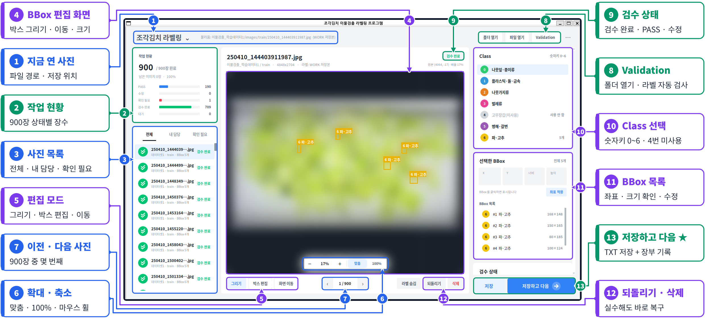

# AI Campus Subject 7
# Kimchi YOLO Labeling Tool

조각김치 이물검출 라벨링 · 2조

> **한 줄 요약** — 조각김치 4K 사진 **900장**의 기존 YOLO 라벨(**BBox 4,399개**)을 우리가 만든 라벨링 프로그램으로 6명이 검수했습니다. 원래 박스의 **54%(2,383개)를 고치고 350개를 새로 그려**, 교과 8 학습에 바로 쓰는 **FINAL 데이터 900쌍(BBox 4,405개)** 을 만들었습니다. 900장 모두 사람 검수 완료 · 자동 검사 오류(CRITICAL) **0건**입니다.

*사진은 NDA 때문에 흐리게 처리했고, 노란 박스는 팀이 검수한 실제 BBox 입니다. 번호 1~13 = 화면 기능.*

| 바로 가기 | |
|---|---|
| 처음 쓰는 사람 | [4. 설치](#4-설치) → [5. 실행](#5-프로그램-실행) → [6. 사용 순서](#6-기본-사용-순서) |
| 결과 숫자 | [1. 프로젝트 소개](#1-프로젝트-소개) · [12. QA 결과](#12-qa-결과) |
| 오류가 났을 때 | [19. 문서 지도](#19-문서-지도) |

---

## 1. 프로젝트 소개

### 개요

강사님이 주신 조각김치 이물검출 데이터(4K JPG 900장 + YOLO TXT 900개)에는 틀리거나 빠진 라벨이 섞여 있었습니다. 그대로 학습하면 모델이 틀린 것을 배우기 때문에, **사람이 한 장씩 확인 · 수정하는 라벨링 프로그램**을 직접 만들고 6명이 같은 기준서로 검수했습니다.

### 결과

900장 중 **778장(86%)** 의 라벨을 고쳤습니다. 박스 2,014개는 위치 · 크기를 다듬었고(그중 1,857개는 10px 이내 미세 조정), 25개는 Class 를 바꿨고, 344개는 지웠고(고무장갑 등 오표기), 350개는 새로 그렸습니다(놓친 이물).

### 좋아진 것

놓쳤던 **병해 · 갈변(Class 5)** 이 313 → **465개(+49%)**, 이물이 아닌데 박스가 있던 **플라스틱 · 돌 · 금속(Class 1)** 오표기가 1,831 → **1,665개(−166)** 로 정리됐습니다.

| 핵심 숫자 | 값 |
|---|---:|
| 이미지 · 라벨 | 900장 · 900개 |
| BBox (원본 → 최종) | 4,399 → **4,405** |
| 유지 / 위치 · 크기 수정 / Class 변경 / 삭제 / 추가 | 2,016 / 2,014 / 25 / 344 / 350 |
| 사람 검수 완료 (REVIEWED) | **900 / 900** |
| 자동 검사 CRITICAL · 남은 REVIEW | **0 · 0** |

### Architecture

> 준비 중 — 여기에 Architecture 그림과 설명이 들어갑니다 (`docs/00_architecture.md`).

지금은 이 흐름만 기억하면 됩니다: **원본(RAW, 읽기만) → 작업본(WORK, 프로그램이 저장) → 합치기 · 검수 → FINAL(교과 8 입력)**

---

## 2. 프로젝트 주요 기능

맨 위 작동 화면의 번호와 같습니다.

| 기능 | 화면 번호 |
|---|---|
| JPG 이미지 열기 · 폴더 열기 | 1 · 8 |
| 기존 YOLO TXT 자동 Load · 기존 BBox 와 Class 표시 | 4 · 11 |
| BBox 추가 / 수정 / 삭제 · 되돌리기 | 4 · 5 · 12 |
| Class 변경 (숫자키 0~6) | 10 |
| 이전 / 다음 이미지 이동 | 7 |
| 4K 이미지 Zoom / Pan | 6 |
| 상태 관리 PASS / 수정(EDITED) / 확인 필요(REVIEW) / 검수 완료(REVIEWED) | 9 |
| YOLO TXT 저장 · Reload (저장하고 다음) | 13 |
| Validation (라벨 형식 자동 검사) | 8 |
| 작업 현황 · 사진 목록 필터 (내 담당 · 확인 필요 등) | 2 · 3 |
| 우리가 더한 것: 내장 한글 입력기 · 작업 장부 자동 기록 · 안전 저장 · 운영 스크립트 00~10 | — |

---

## 3. 프로젝트 폴더 구조

폴더 · 파일마다 담당과 마지막 수정일을 함께 적었습니다.

| 위치 | 무엇 | 담당 | 수정일 |
|---|---|---|---|
| `main.py` · `run.sh` · `setup_wsl.sh` | 실행 · 설치 | PM | 10/12 |
| `requirements.txt` · `settings.example.json` | 실행 환경 · 설정 예시 | PM | 10/12 |
| `README.md` | 이 문서 | PM | 10/16 |
| `src/ui/` | 화면 · 메뉴 · 한글 입력 | GUI | 10/15 |
| `src/bbox/` | BBox 그리기 · 좌표 · 저장 규칙 | Coord | 10/12 |
| `src/yolo/` | YOLO TXT 읽기 · 쓰기 · FINAL 이름 | Storage | 10/12 |
| `src/validation/` | 자동 검사 · 통계 | QA | 10/13 |
| `src/manifest*.py` · `src/config.py` | 작업 장부 · 기준 설정 | Manifest · PM | 10/12 |
| `configs/classes.yaml` | Class 0~6 이름 · 색 | Storage | 10/12 |
| `data/raw · work · final` | 원본 · 작업본 · 최종 (사진은 Git 제외) | Storage | 10/14 |
| `docs/01_project_baseline.md` | 공통 기준 · 완료 조건 | PM · Manifest | 10/15 |
| `docs/02_class_guide.md` | Class 기준서 v1.7.2 | Coord | 10/14 |
| `docs/03_bbox_guide.md` | BBox 기준서 v1.2 | Coord | 10/13 |
| `docs/04_user_manual.md` | 사용설명서 (설치 · 실행 · 단축키 · 문제 해결) | PM | 10/15 |
| `docs/05_issue_improvement.md` | 이슈 → 개선 → 고도화 | PM | 10/15 |
| `docs/06_version_history.md` | 버전 기록 | PM | 10/15 |
| `docs/07_team_worklog.md` | 날짜별 팀 작업 기록 | Manifest | 10/15 |
| `docs/08_code_review.md` · `09_code_study.md` | 코드 리뷰 · 코드 공부 | PM | 10/15 |
| `docs/10_subject08_handoff.md` | 교과 8 인계 | Manifest | 10/14 |
| `docs/images/` | 작동 화면 · 디자인 v01 · v02 · BBox 예시 | GUI · Coord | 10/15 |
| `manifests/` | 작업 장부 사본 (+ dataset_manifest 예정) | Manifest | 10/14 |
| `reports/01_qa_summary.md` | QA 결과 | Manifest · QA | 10/14 |
| `reports/02_test_report.md` · `03_validation_final.csv` | 테스트 결과 · 자동 검사 결과 | QA | 10/13 |
| `scripts/00~10` · `tests/` | 운영 스크립트 · 자동 테스트 4개 | PM · QA · Storage · Manifest | 10/15 |

문서 번호(01~10)는 이 README 의 읽는 순서와 같습니다.

---

## 4. 설치

- WSL(Ubuntu) 에서 GitHub 저장소를 받은 뒤, `project7` 폴더의 **설치 스크립트**(`setup_wsl.sh`) 를 한 번 실행합니다.
- 설치 스크립트가 패키지 · 한글 글꼴 · 가상환경 · 연습 데이터 · 자동 테스트까지 한 번에 합니다.
- 마지막에 **"모든 테스트 통과 (4개)"** 가 나오면 끝입니다.
- 실제 명령과 업데이트 방법 → [04 사용설명서 1장](docs/04_user_manual.md)

## 5. 프로그램 실행

- `project7` 폴더에서 **실행 스크립트**(`run.sh`) 를 실행합니다.
- 처음 한 번 **작업자 이름**을 입력하면 기억합니다.
- **폴더 열기** 로 원본 RAW 폴더(학습데이터1 · 2 가 바로 안에 있는 폴더)를 고릅니다.
- 실제 명령 → [04 사용설명서 2장](docs/04_user_manual.md)

## 6. 기본 사용 순서

1. 폴더를 열고 왼쪽 목록에서 **내 담당** 을 고릅니다.
2. 이미지와 기존 YOLO TXT 가 자동으로 Load 되는지 확인합니다.
3. 기존 BBox 와 Class 를 확인합니다.
4. 잘못된 BBox 는 수정하고, 누락된 객체는 새로 그리고, 잘못된 객체는 지웁니다.
5. 판단이 어려우면 **확인 필요(REVIEW)** 로 저장하고 노트에 이유를 적습니다.
6. **저장하고 다음 (Space)** — TXT 저장과 작업 장부 기록이 같이 됩니다.
7. 하루 마감에 **Validation** 을 실행하고, 작업본을 취합 담당(Storage)에게 보냅니다.

단축키 · 메뉴 · 화면 설명 → [04 사용설명서 3장](docs/04_user_manual.md)

---

## 7. YOLO Label 형식

- TXT 한 줄 = 객체 하나: **Class 번호 · 중심 x · 중심 y · 너비 · 높이**
- 예: `6 0.800620 0.623148 0.034091 0.053704` → Class 6(파 · 고추) 박스 하나
- 좌표는 픽셀이 아니라 이미지 크기 대비 **0~1 비율** (소수점 6자리)
- 이물이 없는 사진도 **빈 TXT 파일**은 꼭 있어야 합니다 (우리 데이터 26장)
- 라벨을 안 바꾼 사진은 원본 TXT 를 **바이트 그대로** 저장합니다

## 8. Class 설정

- 설정 파일: `configs/classes.yaml` · 판단 기준: [docs/02_class_guide.md](docs/02_class_guide.md) (v1.7.2)
- **김치 · 고무장갑 = 배경** — 박스를 그리지 않습니다. Class 4 번호는 교과 8 과 맞추려고 비워 둡니다.
- 작아도 이물이 확실하면 박스 + 노트 `small`

### Class 별 BBox 분석

| Class | 이름 | 원본 BBox | 최종 BBox | 변화 |
|---:|---|---:|---:|---:|
| 0 | 나뭇잎 · 종이류 | 716 | 709 | −7 |
| 1 | 플라스틱 · 돌 · 금속 | 1,831 | 1,665 | −166 |
| 2 | 나뭇가지류 | 911 | 937 | +26 |
| 3 | 벌레류 | 379 | 378 | −1 |
| 4 | 고무장갑 — 사용 안 함 (배경) | 0 | 0 | 0 |
| 5 | 병해 · 갈변 | 313 | 465 | **+152** |
| 6 | 파 · 고추 | 249 | 251 | +2 |
| | 합계 | 4,399 | 4,405 | +6 |

## 9. BBox 작업 기준

- 기준: [docs/03_bbox_guide.md](docs/03_bbox_guide.md) (v1.2)
- 객체 **외곽에 밀착** (여백 3px 이내) — 잘리는 것이 넉넉한 것보다 더 나쁨
- **한 객체 = 박스 1개** · 이미지 경계에 걸리면 보이는 부분만 · 애매하면 REVIEW
- 이 기준으로 위치 · 크기 수정 **2,014개** (그중 1,857개가 10px 이내 미세 조정)

## 10. 데이터 작업 위치

| 단계 | 위치 | 내용 | Git |
|---|---|---|---|
| 원본 | `data/raw/` | 학습데이터1 train 500 · 학습데이터2 train 220 · validation 180 | 제외 (사진) |
| 작업 중 | `data/work_raw/` | 고친 TXT + 작업 장부 | 제외 |
| 최종 | `data/final/` | images 900 · labels 900 + 최종 장부 | 사진 제외 · 라벨 허용 |

- **RAW 는 직접 수정하지 않습니다** — 열기만 하고, 해시로 바뀌지 않았는지 확인합니다.
- 장면 유형: 김치 + 이물 725 · 이물만 149 · 정상 김치 24 · 김치 · 이물 없음 2

## 11. 작업 상태 확인

- 900장의 작업 상태는 **작업 장부**에 자동으로 기록됩니다 (작업 중 `data/work_raw/manifest.csv` · 사본 `manifests/manifest_final.csv` · 제출용 `manifests/dataset_manifest.csv` 는 FINAL 후 생성)

| 상태 | 뜻 |
|---|---|
| 대기 (PENDING) | 아직 안 본 사진 |
| PASS | 수정 없이 확인 완료 |
| 수정 (EDITED) | 고친 뒤 저장 → 다른 사람이 교차검수 |
| 확인 필요 (REVIEW) | 판단이 애매함 → PM + QA 가 결정 |
| 검수 완료 (REVIEWED) | 교차 · 최종검수까지 끝 → FINAL 대상 |

### 검수 단계

1차 라벨링 900장 → 교차검수 710장(수정 · 확인 필요 사진을 다른 사람이) → 최종검수 3명 × 300장(본인이 본 사진 제외) → **900장 REVIEWED**

## 12. QA 결과

- 자세히: [reports/01_qa_summary.md](reports/01_qa_summary.md) · 검사 결과 파일: `reports/03_validation_final.csv`
- 전체 이미지 **900** · TXT **900** · Validation CRITICAL **0**
- 발견된 오류: 빈 라벨 26건 중 2건이 '고무장갑만 있는 사진' → 장면 유형 `none` 추가로 해결 (Human QA)
- 최종 REVIEW **0** · 교차검수 안 된 수정 **0**

## 13. 프로그램 테스트 결과

- 자세히: [reports/02_test_report.md](reports/02_test_report.md)
- 개발 단계 오류 **8개** (메뉴 잔상 · 단축키 · 빈 화면 · 깨진 이미지 · 경로) 모두 고치고 재시험 PASS
- 자동 테스트 **4개 통과** — 좌표 왕복 · 화면 배율 · 저장 규칙 · 전체 작업 흐름
- 테스트 단계: Golden Test → Pilot Test → Final Acceptance Test (⏳ Golden · Pilot 결과 칸 채우는 중)

## 14. FINAL Dataset

- 위치: `data/final/images/` 900장 · `data/final/labels/` 900개 (같은 파일명 쌍) + 최종 장부
- 조건: REVIEW 0 · CRITICAL 0 일 때만 생성되고, FINAL 은 직접 고치지 않습니다 (WORK 에서 고친 뒤 다시 생성)
- 교과 8 인계: [docs/10_subject08_handoff.md](docs/10_subject08_handoff.md) — FINAL 900쌍을 YOLO11n 학습 입력으로 전달

## 15. 주의사항

- `data/raw/` 원본은 수정하지 않습니다.
- **원본 김치 사진은 GitHub · 메신저 · 개인 클라우드 금지** (메일 · USB 로만) · 라벨 TXT · CSV 는 Git 허용 (10/13 강사님 확인)
- 데이터는 AI캠퍼스 교육용 **100% 가상 생성** 데이터이며 **NDA 대상**입니다.
- REVIEW 상태의 데이터는 FINAL 에 넣지 않습니다.
- 이미지와 TXT 의 파일명은 같아야 합니다.
- 수정 후 저장 · Reload 를 확인하고, 제출 전 Validation 을 실행합니다.
- main 은 PR 로만 바꿉니다 · `git add .` 금지.

---

## 16. 팀 운영

### 역할표

| 직책 | 브랜치 | 맡은 일 | 주요 산출물 |
|---|---|---|---|
| PM · Integrator | feature/pm | 일정 · 배분 · Git · FINAL 생성 | README · Baseline · FINAL · 사용설명서 |
| GUI · Image | feature/gui | 화면 디자인 v01 → v02 · 캡처 · Figma | 프로그램 화면 |
| Coord (BBox · Coordinate) | feature/coord | 좌표 · Golden Test · 기준서 | Class · BBox 기준서 |
| Storage (Label · Storage) | feature/storage | 저장 로직 · 데이터 취합 · 배포 | 저장 · 병합 |
| QA (Validation) | feature/qa | 자동 검사 · RAW 보호 · 테스트 | Validation · Test Report |
| Manifest (Document · 서기) | feature/manifest | 작업 장부 · 기록 · 인계 | Manifest · QA Summary · Handoff |

### WBS 일정

| 단계 | 기간 | 결과 |
|---|---|---|
| 1 준비 | 10/01 – 10/02 | 조 편성 · 기준 · 환경 · Git |
| 2 프로그램 | 10/02 – 10/08 | v01 → v02 디자인 → v2.1 · v2.2 배포 |
| 3 기준서 | 10/06 – 10/14 | Class v1.0 → v1.7.2 · BBox v1.0 → v1.2 |
| 4 1차 라벨링 | 10/06 – 10/07 | 900장 완료 |
| 5 교차검수 | 10/08 – 10/12 | 수정 · 확인 필요 710장 재확인 |
| 6 최종검수 | 10/12 – 10/13 | 3명 × 300장 → 900 REVIEWED |
| 7 QA · FINAL | 10/13 – 10/15 | CRITICAL 0 · FINAL 900쌍 |
| 8 인계 · 발표 | 10/13 – 10/21 | 교과 8 Handoff · 문서 정리 · 발표 |

Feature Freeze 10/13 (이후 버그 수정 · 문서만)

## 17. 산출물

### 필수 산출물

| 번호 | 강사님 필수 11개 | 위치 | 상태 |
|---:|---|---|---|
| 1 | 라벨링 프로그램 | `main.py` · `src/` | ✅ v2.2 |
| 2 | 소스코드 · 실행 환경 | `src/` · `requirements.txt` · `configs/` | ✅ |
| 3 | FINAL YOLO 라벨 | `data/final/` | ✅ 900쌍 |
| 4 | Project Baseline | [docs/01](docs/01_project_baseline.md) | ✅ |
| 5 | Class 기준서 | [docs/02](docs/02_class_guide.md) | ✅ v1.7.2 |
| 6 | BBox 기준서 | [docs/03](docs/03_bbox_guide.md) | ✅ v1.2 |
| 7 | Dataset Manifest | `manifests/dataset_manifest.csv` | ⏳ FINAL 후 생성 |
| 8 | QA Summary | [reports/01](reports/01_qa_summary.md) | ✅ |
| 9 | Test Report | [reports/02](reports/02_test_report.md) | ⏳ Golden 결과 칸 |
| 10 | README | 이 문서 | ✅ |
| 11 | 교과 8 Handoff | [docs/10](docs/10_subject08_handoff.md) | ✅ |

### 추가 산출물

| 우리가 더 만든 것 | 위치 | 왜 추가했나 |
|---|---|---|
| 사용설명서 | [docs/04](docs/04_user_manual.md) | README 는 요약만 · 설치 · 실행 · 단축키 · 문제 해결은 따로 모아 처음 쓰는 사람도 따라 하게 |
| 이슈 → 개선 보고서 | [docs/05](docs/05_issue_improvement.md) | 문제를 어떻게 찾고 고쳤는지 한곳에서 |
| 버전 기록 | [docs/06](docs/06_version_history.md) | 프로그램 · 기준서 · 데이터가 언제 왜 바뀌었는지 |
| 팀 작업 기록 | [docs/07](docs/07_team_worklog.md) | 날짜별 작업 (서기) |
| 코드 리뷰 · 코드 공부 | [docs/08](docs/08_code_review.md) · [docs/09](docs/09_code_study.md) | 팀원 모두가 코드를 설명할 수 있게 (교과 2 코드리뷰 방식) |
| 자동 검사 결과 · 작업 장부 사본 | `reports/03` · `manifests/manifest_final.csv` | CRITICAL 0 · 900장 상태를 파일로 증명 |

## 18. 버전 · 이슈

- 지금 버전: 프로그램 **v2.2** · Class 기준서 **v1.7.2** · BBox 기준서 **v1.2** · 데이터 **FINAL 900** → [06 버전 기록](docs/06_version_history.md)
- 이슈 **11개 모두 해결** + 고도화 4개 → [05 이슈 → 개선](docs/05_issue_improvement.md)
- 가장 큰 이슈: QA Summary 보정 숫자가 전부 0 → 버그가 아니라 비교 경로 문제 → 원본 · 작업본 경로를 직접 지정해 정식 숫자를 얻음

## 19. 문서 지도

### 어디를 보면 되나

| 알고 싶은 것 | 볼 문서 |
|---|---|
| 기준 · 완료 조건 | [01 Project Baseline](docs/01_project_baseline.md) |
| 어떤 Class 로 라벨할지 → 박스를 어디까지 | [02 Class 기준서](docs/02_class_guide.md) → [03 BBox 기준서](docs/03_bbox_guide.md) |
| 설치 · 실행 · 단축키 | [04 사용설명서](docs/04_user_manual.md) |
| 문제와 해결 → 버전 | [05 이슈 → 개선](docs/05_issue_improvement.md) → [06 버전 기록](docs/06_version_history.md) |
| 날짜별 작업 | [07 팀 작업 기록](docs/07_team_worklog.md) |
| 코드 동작 | [08 코드 리뷰](docs/08_code_review.md) → [09 코드 공부](docs/09_code_study.md) |
| 교과 8 에 넘긴 것 | [10 교과 8 Handoff](docs/10_subject08_handoff.md) |

### 오류가 나면

| 증상 | 먼저 볼 곳 |
|---|---|
| 설치 · 실행이 안 됨 | 04 사용설명서 «8. 문제 해결» |
| 저장이 안 되거나 박스가 이상함 | 04 사용설명서 «4. 저장 규칙» → 08 코드 리뷰 A1 |
| Validation 에 CRITICAL | `reports/03_validation_final.csv` → 02 Class 기준서 |
| QA Summary 숫자가 0 | 05 이슈 보고서 ISSUE-07 |
| Class 판단이 애매함 | 02 Class 기준서 «헷갈리기 쉬운 Class 구분표» |
