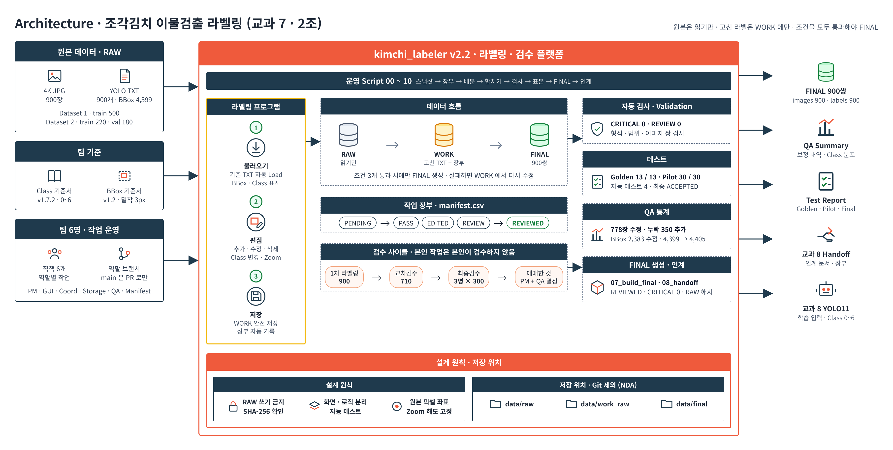
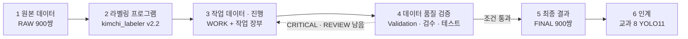
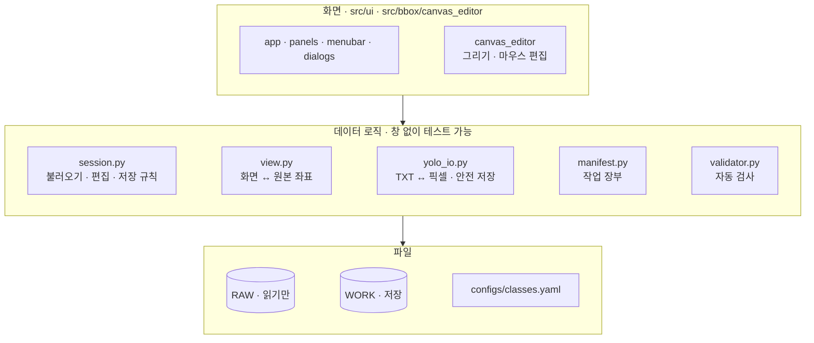

# 00 Architecture - 조각김치 이물검출 라벨링

> [README](../README.md) › docs › **00 Architecture** · → [01 Project Baseline](01_project_baseline.md)
> 작성 PM · 2026-10-19

## 한눈에 보기

- 원본 RAW 900쌍은 **읽기만** 하고, 라벨링 프로그램으로 고친 라벨은 작업본 WORK 에만 저장합니다.
- WORK 가 검수(1차 → 교차 → 최종) · 자동 검사(CRITICAL 0) · RAW 해시 확인을 **모두 통과해야만** FINAL 900쌍이 만들어집니다.
- FINAL 은 Handoff 문서와 함께 교과 8 YOLO11 학습 입력으로 넘어갑니다.

 

## 1. 전체 흐름

검증에서 문제가 나오면 FINAL 로 가지 않고 WORK 로 돌아가 다시 고칩니다. FINAL 은 직접 고치지 않고 항상 WORK 에서 고친 뒤 다시 생성합니다.

 

## 2. 단계별 구성

| 단계 | 하는 일 | 코드 · Script | 산출물 · 위치 | 담당 |
|---|---|---|---|---|
| 1 원본 데이터 | 4K JPG 900 + YOLO TXT 900 · BBox 4,399 · 읽기 전용 보호 | `00_raw_snapshot.py` (SHA-256) | `data/raw/` · Git 제외 | Storage |
| 2 라벨링 프로그램 | 이미지 · BBox 확인 · 추가 · 수정 · 삭제 · Class 변경 · 저장 | `main.py` · `src/ui/` · `src/bbox/` · `src/yolo/` | 프로그램 v2.2 | GUI · Coord · Storage |
| 3 작업 데이터 · 진행 | 작업 장부 기록 · 균등 배분 · 6명 작업본 합치기 · 교차 · 최종검수 | `01_build_manifest` · `03_assign` · `04_merge` · `src/manifest.py` | `data/work_raw/` · `manifest.csv` | PM · Storage · Manifest |
| 4 데이터 품질 검증 | 형식 자동 검사 · PASS 표본 검수 · Golden · Pilot · 자동 테스트 · QA 통계 | `02_validate` · `06_pass_sample` · `09_golden_test` · `05_qa_summary` · `tests/` | [01 QA Summary](../reports/01_qa_summary.md) · [02 Test Report](../reports/02_test_report.md) | QA · Coord · Manifest |
| 5 최종 결과 | 조건 3개 통과 시에만 FINAL 생성 · 같은 파일명 쌍으로 복사 | `07_build_final` · `src/yolo/final_layout.py` | `data/final/` images 900 · labels 900 | PM |
| 6 인계 | Handoff 문서 · 제출용 장부 생성 → 교과 8 학습 입력 | `08_handoff` · `10_export_manifest` | [10 교과 8 Handoff](10_subject08_handoff.md) | Manifest |

 

## 3. 라벨링 프로그램 내부 구조

| 계층 | 파일 | 역할 |
|---|---|---|
| 화면 | `ui/app.py` · `panels.py` · `menubar.py` · `dialogs.py` · `canvas_editor.py` | 보여주기 · 입력 받기만 담당 |
| 데이터 로직 | `bbox/session.py` | 이미지 불러오기 · BBox 편집 · 저장 규칙 (PASS → EDITED 자동 보정 · Class 4 금지) |
| 좌표 | `bbox/view.py` · `yolo/yolo_io.py` | 화면 ↔ 원본 픽셀 ↔ YOLO 정규화 좌표 변환 |
| 기록 · 검사 | `manifest.py` · `validation/validator.py` | 작업 상태 기록 · 형식 오류 검사 |
| 기준 | `configs/classes.yaml` · `src/config.py` | Class 0~6 이름 · 색 · 사용 여부 · 경로 기준 |

코드 흐름 상세 → [08 코드 리뷰](08_code_review.md) · [09 코드 공부 0.2 파일 지도](09_code_study.md#02-파일-지도와-역할-담당)

 

## 4. 설계 원칙

| 원칙 | 방법 | 효과 |
|---|---|---|
| RAW 는 쓰지 않는다 | 저장은 WORK 로만 · 저장 직전 경로 재검사 · SHA-256 으로 비교 | 원본 1,800개 파일 무변경 확인 |
| 화면과 데이터 로직 분리 | `ui/` 는 보여주기만 · `session.py` 가 편집 · 저장 | 창 없이 자동 테스트 4개로 전체 흐름 재현 |
| 원본 픽셀 좌표로 보관 | BBox 는 원본 좌표로 들고 그릴 때만 화면 좌표로 변환 | Zoom · Pan 해도 위치 고정 · 왕복 오차 < 1e-6 |
| FINAL 은 조건부 생성 | 전부 REVIEWED · CRITICAL 0 · RAW 해시 동일 | 하나라도 실패하면 생성하지 않음 |

 

## 5. 결과

| 항목 | 결과 |
|---|---|
| 검수 범위 | 900장 전수 · 1차 900 → 교차 710 → 최종 3명 × 300 |
| 라벨 보정 | 778장 수정 · BBox 2,383 수정 · 누락 350 추가 · BBox 4,399 → 4,405 |
| 품질 | 자동 검사 CRITICAL 0 · REVIEW 0 · Golden 13 / 13 · Pilot 30 / 30 |
| 인계 | FINAL 900쌍 → 교과 8 YOLO11 학습 입력 |
