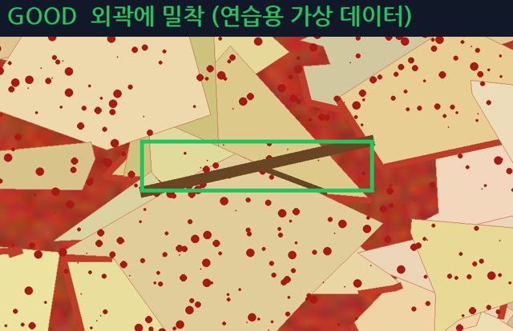
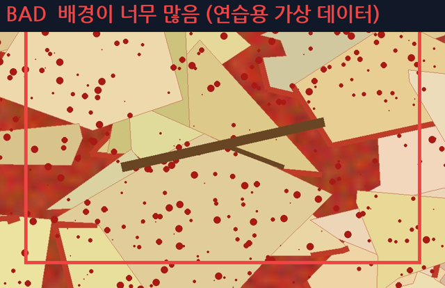

# 03 Bounding Box Labeling Guide

> [README](../README.md) › docs › **03 Bounding Box Labeling Guide** · ← [02 Class 기준서](02_class_guide.md) · → [04 사용설명서](04_user_manual.md)
> 담당 Coord · v1.2 · 2026-10-13

## 한눈에 보기

- 박스는 **이물 외곽에 밀착** (여백 3px 이내) — 객체가 잘리지 않는 것을 우선
- **한 객체 = 박스 1개** · 겹치면 각각 · 이미지 경계에 걸리면 보이는 부분만
- 가려져 끊겨 보여도 같은 객체면 박스 1개 · 판단이 어려우면 REVIEW
- 이 기준으로 위치 · 크기 수정 **2,014개** (그중 1,857개는 10px 이내 미세 조정)
- 저장 전 «9. 저장 전 확인 체크» 로 마지막 확인

---

- 문서 버전: v1.2
- 작성일: 2026-10-06
- 마지막 수정일: 2026-10-13
- 담당: Coord
- 원본 위치: Git `docs/03_bbox_guide.md` (팀 노션 원본과 같은 내용)

> 이 문서는 **BBox를 어디까지 · 어떻게 그릴지** 정한 팀 공통 기준입니다.
> 어떤 Class로 지정할지는 `docs/02_class_guide.md`를 따릅니다.

## 공통 원칙

1. BBox는 객체의 **실제 외곽에 밀착**해서 작성한다.
2. 객체와 관계없는 배경을 많이 포함하지 않는다.
3. **하나의 객체는 하나의 BBox로 작성하고, 하나의 BBox에는 하나의 객체만 넣는다. 가려져서 중간이 끊겨 보여도 같은 객체가 확실하면 BBox 1개로 작성한다. (5.2 참고)**
4. 판단이 어려우면 임의로 정하지 않고 **REVIEW**로 보낸다.
5. 작업자마다 기준이 달라지지 않도록, 이 문서에 없는 사례는 혼자 정하지 말고 서기를 통해 결정 로그에 올린 뒤 이 문서에 반영한다.
6. **고무장갑에는 BBox를 그리지 않는다.** 고무장갑은 Class 를 지우고 **배경**으로 쓴다. (`02_class_guide.md` Class 4, v1.7)
7. **김치(배추 잎 · 조각 · 양념)에는 BBox를 그리지 않는다.** 김치는 배경이다. (`02_class_guide.md` 공통 원칙 4)

---

## 1. 기본 작성 기준: 외곽에 밀착

객체의 가장 바깥 점(위·아래·왼쪽·오른쪽)이 BBox 변에 닿도록 작성한다.

```
O (밀착)            X (여백 과다)           X (객체 잘림)

┌────┐            ┌──────────────────┐     ┌───────┐
│객체│            │                  │     │ 객----체
└────┘            │      객체        │     └───────┘
                  │                  │
                  └──────────────────┘
```

- 허용 여백: 객체 외곽에서 바깥쪽으로 **최대 3px** 이내 (원본 4K 이미지 픽셀 기준)
- 객체가 BBox 밖으로 삐져나오지 않게 한다. (잘림이 여백보다 더 나쁜 오류로 본다)
- 그림자는 객체에 포함하지 않고 객체 본체만 감싼다.

---

## 2. 이미지 경계에 걸린 객체

객체 일부가 이미지 밖으로 나갔으면 **화면에 보이는 부분**까지만 BBox를 작성한다.

- 이미지 가장자리에서 BBox가 끝나도 된다. (이미지 밖으로 BBox를 확장하지 않는다)
- 보이는 부분만으로 Class를 알 수 없으면 REVIEW

---

## 3. 객체가 서로 겹친 경우

겹쳐 있어도 각각을 구분할 수 있으면 **객체마다 BBox를 따로** 작성한다. BBox끼리 겹치는 것은 허용한다.

```
나뭇가지 + 플라스틱 조각이 겹침
→ 나뭇가지 BBox 1개 + 플라스틱 BBox 1개
```

- 어디까지가 어느 객체인지 구분할 수 없으면 REVIEW (`object_separation_ambiguous`)
- **같은 Class의 객체가 서로 붙어 있을 때** (예: 파 조각 여러 개): 각각의 경계가 구분되면 객체마다 BBox를 따로 작성하고, 구분되지 않으면 하나로 묶지 말고 REVIEW (`object_separation_ambiguous`)

---

## 4. 객체가 매우 작은 경우

- **Class를 알아볼 수 있고 검출 대상이면, 작아도 BBox를 작성한다.** 노트에 `small`을 적는다.
- **점이나 얼룩처럼 객체인지 알 수 없으면 REVIEW (`too_small_to_identify`)**
- **작은 객체는 Zoom을 키워서 외곽을 확인한 뒤 작성한다.** (맞춤으로 전체 확인 → 박스마다 100%)
- **스티로폼 알갱이처럼 아주 작은 이물도 스티로폼이 확실하면 BBox + Class 1 + 노트 `small`** (`02_class_guide.md` "작은 이물 처리 기준", v1.6 확정)
- **3px보다 작은 박스는 라벨링 프로그램이 만들지 않는다.** (실수 드래그 방지)

---

## 5. 객체 일부가 가려진 경우

### 5.1 끝이나 한쪽이 가려진 경우

김치나 다른 객체에 가려져도 Class를 식별할 수 있으면 **보이는 범위**를 기준으로 BBox를 작성한다.
가려진 부분을 상상해서 BBox를 넓히지 않는다. Class를 식별하기 어려우면 REVIEW (`occlusion_ambiguous`)

### 5.2 중간이 가려져서 하나의 객체가 둘로 끊겨 보이는 경우 **[제안 — 팀 확정 필요]**

```
┌────────────────────────────────────┐
│ ───────┤ 김치 조각이 가림 ├─────── │   → 같은 객체가 확실하면 BBox 1개
└────────────────────────────────────┘      (보이는 양 끝의 바깥 점이 기준)
```

기준은 "얼마나 가려졌는가"가 아니라 **"양쪽이 같은 객체인가"**이다.

| 상황 | 처리 |
| --- | --- |
| 양쪽이 같은 객체임이 확실함 (모양·색·굵기·방향이 이어짐) | **BBox 1개.** 보이는 양 끝의 바깥 점을 기준으로 가려진 구간까지 포함해서 감싼다. |
| 같은 객체인지 서로 다른 객체인지 불확실함 | 확정하지 않고 **REVIEW** (`object_split_ambiguous`) |
| 양쪽이 서로 다른 객체임이 확실함 (Class·재질·색이 다름) | **객체마다 BBox를 따로** 작성한다. |
| 가린 물체도 검출 대상 이물임 | 가려진 객체와 가린 객체를 **각각 BBox**로 작성한다. BBox가 겹치는 것은 허용한다. |
| 가려진 구간이 너무 길어서 BBox 안의 대부분이 가린 물체나 배경임 | **REVIEW** **[팀 확정 — 기준 예: 가려진 구간이 BBox 길이의 절반 이상]** |

- 이 기준은 "가려진 부분을 상상해서 BBox를 넓히지 않는다"는 원칙과 충돌하지 않는다. BBox의 바깥 범위는 여전히 **보이는 부분의 가장 바깥 점**이 정하고, 가운데 비어 있는 구간은 BBox 안에 들어갈 뿐 새로 만든 영역이 아니기 때문이다.
- 한 객체를 BBox 두 개로 나누면 개수를 세거나 교과 8에서 평가할 때 정답이 2개로 잡히므로, 같은 객체가 확실할 때는 나누지 않는다.

---

## 6. 하나의 객체는 하나의 BBox

```
하나의 긴 나뭇가지              → BBox 1개
중간이 가려져 끊겨 보이는 가지  → 같은 객체가 확실하면 BBox 1개 (5.2)
서로 떨어진 별개 객체            → 각각 BBox 작성
```

- 잘린 것처럼 보여도 하나의 객체이면 BBox를 둘로 나누지 않는다.
- 같은 객체에 BBox를 중복해서 그리지 않는다.
- 기울어진 긴 객체: BBox는 항상 축에 평행한 사각형이므로 객체 전체를 감싸는 최소 사각형으로 작성한다. (배경이 많이 포함되더라도 회전 BBox는 쓰지 않는다)

---

## 7. 기존 라벨을 검수할 때

기존 BBox가 있는 이미지는 아래 순서로 확인한다.

| 상황 | 처리 | status |
| --- | --- | --- |
| BBox와 Class가 모두 맞음 | 그대로 둠 | PASS (교차·최종검수에서는 검수 완료) |
| 위치·크기가 어긋남 | BBox 수정 | EDITED |
| Class가 틀림 | Class 변경 (Class 기준서 기준) | EDITED |
| 객체가 없는데 BBox가 있음 | BBox 삭제 | EDITED |
| 객체가 있는데 BBox가 없음 | BBox 추가 | EDITED |
| 같은 객체에 BBox가 중복됨 | 하나만 남기고 삭제 | EDITED |
| 같은 객체가 가려져서 BBox 둘로 나뉘어 있음 (같은 객체가 확실함) | 하나로 합침 (5.2) | EDITED |
| 김치 잎 · 조각 · 양념에 BBox 가 있음 | **BBox 삭제** + 노트 `#n 삭제, 김치` (김치 = 배경) | EDITED |
| 고무장갑 BBox 발견 (Class 4 또는 Class 1) | **BBox 삭제** + 노트 `#n 삭제, 고무장갑` (고무장갑 = 배경, `02_class_guide.md` v1.7) | EDITED |
| 그 밖에 현재 사용하지 않는 Class 발견 | 임의로 삭제하지 않음 | REVIEW (`unused_class_found`) |
| 판단이 어려움 | 수정하지 않고 사유 기록 | REVIEW |

> 교차검수 · 최종검수에서는 고쳤든 안 고쳤든 **확실하면 "검수 완료(REVIEWED)"** 로 저장하고 노트에 고친 내용을 적는다. (`02_class_guide.md` "검수 결과 저장 기준")

---

## 8. 판단이 어려운 경우: REVIEW

BBox 범위나 객체 구분이 애매하면 임의로 확정하지 않고 `status = REVIEW`로 두고, 사유를 `review_reason`에 아래 코드로 적는다.

| 코드 수정 전 (영문) | 코드 수정 후 (한글) | 의미 |
| --- | --- | --- |
| `bbox_boundary_ambiguous` | bbox 경계 불명확 | 객체 경계가 불명확해 BBox 범위를 정하기 어려움 |
| `object_separation_ambiguous` | 객체 분리 불명확 | 겹친 객체나 붙어 있는 같은 Class 객체를 몇 개로 나눌지 불명확 |
| `object_split_ambiguous` | 한 객체 여부 불명확 | 가려져서 끊겨 보이는 두 부분이 같은 객체인지 불명확 |
| `too_small_to_identify` | 대상 크기 작음 | 너무 작아서 객체인지 판단하기 어려움 |
| `occlusion_ambiguous` | 가림으로 식별 어려움 | 가려져서 Class를 식별하기 어려움 |
| `class_ambiguous` | class 모호함 | Class 판단이 어려움 (`02_class_guide.md` 참고) |
| `unused_class_found` | 사용 안 하는 class 발견 | 사용하지 않는 Class가 기존 TXT에 있음 (고무장갑은 REVIEW 없이 BBox 삭제) |

REVIEW는 교차검수자와 PM이 판단하고, 결과는 서기가 REVIEW 판정 기록에 남긴다.
새로운 유형의 사유가 반복되면 이 표에 코드를 추가한다.

---

## 9. 저장 전 확인 체크

- [ ] 객체 외곽에 밀착했다 (잘리거나 여백이 과하지 않다)
- [ ] 하나의 객체에 BBox가 하나다 (중복 없음)
- [ ] 가려져서 끊겨 보이는 같은 객체를 BBox 하나로 작성했다 (불확실하면 REVIEW)
- [ ] 겹친 객체는 각각 BBox가 있다
- [ ] 김치(배추 잎 · 조각 · 양념)와 고무장갑에 BBox가 없다
- [ ] 작아도 이물이 확실하면 BBox를 그리고 노트에 `small`을 적었다
- [ ] Class 번호가 `02_class_guide.md` 기준과 맞다
- [ ] 판단이 어려운 객체는 REVIEW로 표시하고 사유를 적었다
- [ ] 저장 후 Validation 오류가 없다 (이미지·TXT 쌍, Class 범위 0~6, 좌표 0~1)

---

## 10. 작업 흐름 예시

- 일반 객체: BBox 작성 흐름

```
객체 확인
    ↓
외곽 확인 (작으면 Zoom)
    ↓
배경 최소화, 밀착 BBox 작성
    ↓
Class 지정 (02_class_guide.md)
    ↓
저장 → Validation 확인
```

- 가려져서 끊겨 보이는 객체: BBox 작성 흐름

```
객체가 가려져서 둘로 끊겨 보임
    ↓
양쪽이 같은 객체인지 확인 (모양·색·굵기·방향)
    ↓
같은 객체가 확실       →  BBox 1개 (보이는 양 끝 기준)
서로 다른 객체가 확실  →  각각 BBox
불확실                 →  REVIEW (object_split_ambiguous)
```

- 판단이 어려운 객체: REVIEW 처리 흐름

```
판단이 어려운 객체 발견
    ↓
임의로 BBox·Class 확정하지 않음
    ↓
REVIEW + 사유 코드 기록
    ↓
교차검수자 + PM 최종 판단
    ↓
결정 로그 기록 → 필요하면 이 문서 개정
```

---

## 11. 팀 예시 이미지

예시 이미지는 `docs/images/` 에 넣고 아래에 연결합니다.
프로그램 캡처는 Git 에 올려도 됩니다 (원본 사진 파일 자체는 금지). 실제 사진 예시는 팀 노션 원본 참고.

| GOOD | BAD |
|---|---|
|  |  |

---

## 변경 이력

기준을 바꾸면 이미 작업한 이미지를 다시 봐야 하는지 확인하기 위해 반드시 기록한다.

| 버전 | 날짜 | 변경 내용 | 이유 | 다시 확인할 이미지 |
| --- | --- | --- | --- | --- |
| v1.0 | 2026-10-06 | 초안 작성 | - | - |
| v1.1 | 2026-10-12 | 가려져서 끊겨 보이는 객체 처리 기준 추가(5.2), 공통 원칙 3·4의 "절반 이상 가려지면 여러 BBox" 문구 삭제, 붙어 있는 같은 Class 객체 처리·이미지 경계 최소 폭·px 기준 단위 항목 추가, Class 4 처리를 `02_class_guide.md`에 맞춤, REVIEW 코드 한글 이름 입력 및 `object_split_ambiguous` 추가 | 공통 원칙(절반 이상 가려지면 여러 BBox)과 6장(잘린 것처럼 보여도 BBox 1개)이 서로 달랐고, 가려진 객체 처리와 px 기준이 확정되지 않았음 | 가려져서 중간이 끊긴 객체가 있는 이미지, 같은 객체가 BBox 둘로 나뉘어 있는 이미지 |
| v1.2 | 2026-10-13 | Git 반영 (노션 원본 → `docs/03_bbox_guide.md`). `02_class_guide.md` v1.6·v1.7 에 맞춤: 4장 작은 이물(스티로폼 Class 1 + `small` 확정, 3px 규칙), 7장 고무장갑 = BBox 삭제 → EDITED, 공통 원칙 6(고무장갑) · 7(김치 = 배경) · 7장 김치 BBox 삭제 행 · 체크 2개 추가, 검수 저장 기준 안내, 기존 Git 예시 이미지(11장) 유지 | class_guide 는 v1.7 인데 bbox_guide 4장 · 7장이 예전 기준(회의 필요 · Class 1 + REVIEW)으로 남아 서로 달랐음 | 고무장갑에 BBox 가 남은 이미지, 작은 이물인데 BBox 가 없는 이미지 |
