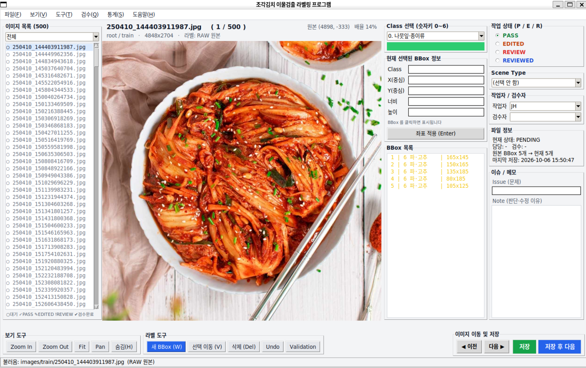
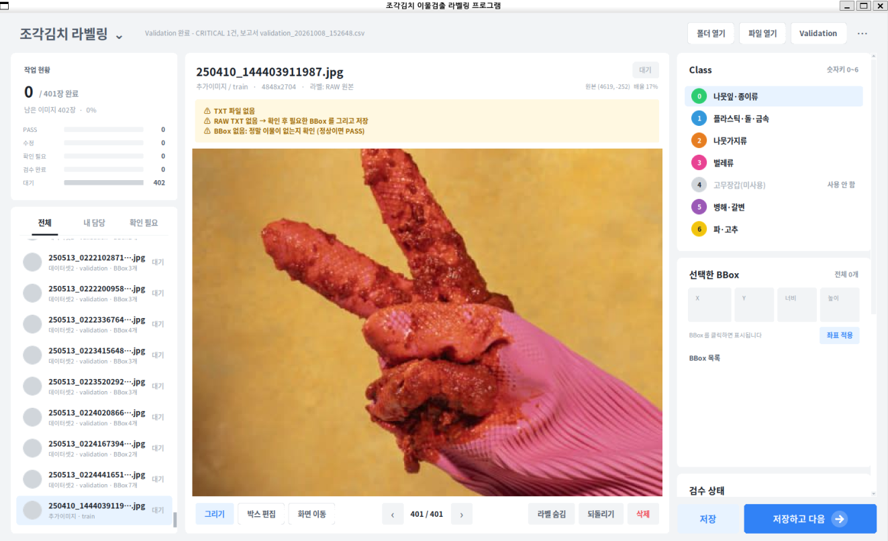

---
tags:
  - 교과7
  - 조각김치
  - 작업기록
project: 조각김치 이물검출 라벨링 (교과 7)
name: 2조
updated: 2026-10-15
---

# 07 팀 작업 기록

> 📍 [README](../README.md) › docs › **07 팀 작업 기록** · ← [06 버전 기록](06_version_history.md) · → [08 코드 리뷰](08_code_review.md)
> 담당 Manifest (서기) · 2026-10-15

## 한눈에 보기

- 10/01 – 10/14 날짜별 팀 작업 기록 (교과 8 기록은 `project8/docs/` 에 이어서 씀)
- 10/02 레이아웃 v01 → 10/06 배포 · 라벨링 시작 → 10/07 디자인 v02 → 10/08 v2.1 · 교차검수 → 10/12 최종검수 3명 × 300장 → 10/13 FINAL · 교과 8 전달 → 10/14 none 2장 정리
- 문제와 해결은 [05 이슈 → 개선](05_issue_improvement.md) 에 정리했습니다

---

# 10-01

> [!info] 10-01 한 줄 요약
> **1.** 조 편성
> **2.** GUI 코드 수업 및 예문 실습

# 10-02

> [!info] 10-02 한 줄 요약
> **1.** 프로젝트 데이터셋
> **2.** 기한 내 업무 일정과 기준 확립 및 작성
> **3.** 윈도우 내 가상환경 구성 및 git hub 연결
> **4.** GUI 프로그램 레이아웃 구현

### 프로그램 v01 레이아웃

# 10-06

> [!info] 10-06 한 줄 요약
> **1.** git 팀 프로젝트 폴더 구조 정립
> **2.** GUI 프로그램 V01 완성 및 팀 내 배포
> **3.** 라벨링 작업 배분 및 시작

# 10-07

> [!info] 10-07 한 줄 요약
> **1.** GUI 프로그램 레이아웃 디자인 변경 v02 제작 및 팀 내 배포
> **2.** 라벨링 작업 마무리

QA(GUI관련)
- 화면 이동 후 원래 커서로 못 돌아감
   ㄴ 그리기 / 박스 편집 / 이동 등 버튼 추가 및 esc 키에 그리기로 복귀 기능 추가
- 이미지 이동이 좌우 키만 됨
   ㄴ 방향키 모두에 적용
- 이슈 노트 한국어 입력 불가
   ㄴ 한글 입력기 추가
   ㄴ 한/영 전환 기능 추가
- 목록 필터 카테고리가 섞여있어 특정 기능 찾기에 직관적이지 않음
   ㄴ 해당 탭 재정리
- 상태 표시 아이콘이 PENDING과 헷갈림
   ㄴ 상태를 약자 대신 한글+아이콘으로 표기
- 작업자 / 검수자 이름 입력이 불편
   ㄴ 미리 목록으로 만들어서 입력이 아닌 선택창으로 처리

QA 반영 및 디자인 변경하여 v02 업데이트
  - 목록 -> 작업-> 정보 순서로 레이아웃 정리
  - 상태, 진행률, 선택 정보를 색과 아이콘으로 구분
  - 색상과 글꼴 등

### 프로그램 v02 레이아웃

# 10-08

> [!info] 10-08 한 줄 요약
> **1.** manifest.csv 관련 GUI 프로그램 코드 수정(v2.1) 및 배포
> **2.** 라벨링 데이터 교차 검수

Manifest 문제 확인
- manifest.csv에서 표기되는 path에 data 1/2인지 출처 미표기
   ㄴ 경로 표기 수정
- 라벨링을 진행하면서 자동 생성되는 work 폴더에 labels라는 이름의 폴더가 중복 생성되는 문제
   ㄴ 중복 폴더 생성되지 않게끔 코드 수정
- class 개수 컬럼 추가
- 경로 수정에 따른 관련 코드 확인 및 수정

# 10-12

> [!info] 10-12 한 줄 요약
> **1.** 라벨링 데이터 Final 확정 및 교과 7 프로젝트 마무리
> **2.** 교과 8 프로젝트 시작

- 데이터 전체 검수 하면서 기준서 수정 및 추가
  - 검수자 셋 각 300장씩 확인
- final 데이터 확정
- 프로젝트 8 git hub 폴더 구조 정립
- 프로젝트 8 수업파일 참조, 프로젝트 내용의 이해

# 10-13

> [!info] 10-13 한 줄 요약
> **1.** 교과 7 final 데이터 교과 8로 넘기기

- 교과 7 final 데이터(image/label) 확정 및 manifest 병합
- final data의 qa summary, validation 생성
- 교과 8로 넘기기
- 이외 교과 8 작업사항은 [[교과 8_팀 작업 기록]]에서 기록

# 10-14

> [!info] 10-14 한 줄 요약
> **2.** 교과 7 final 데이터 관련 qa_summary / manifest_final 수정
> **3.** Class 기준서 업데이트

- 교과 7 validation 확인 및 이상 데이터 2개 확인
- 이상 데이터가 BBox 없음, 배경 김치 없음에 해당되는 scene_type의 분류 항목이 없었고 새로 항목 추가하여 재분류
- 관련 문서 업데이트
- 교과 7 GUI 프로그램 코딩 수정은 보류 결정
  / (교과 8 진행 중 혹은 후에 남는 시간에 진행)

Final Data
- Images/Labels : 각 900장
   - 세부사항은 project7/reports/01_qa_summary.md 확인