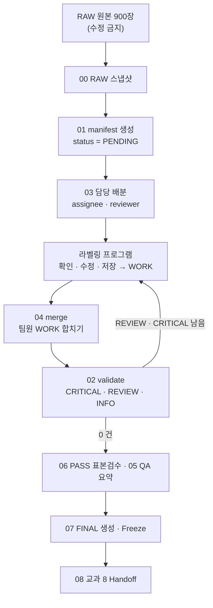
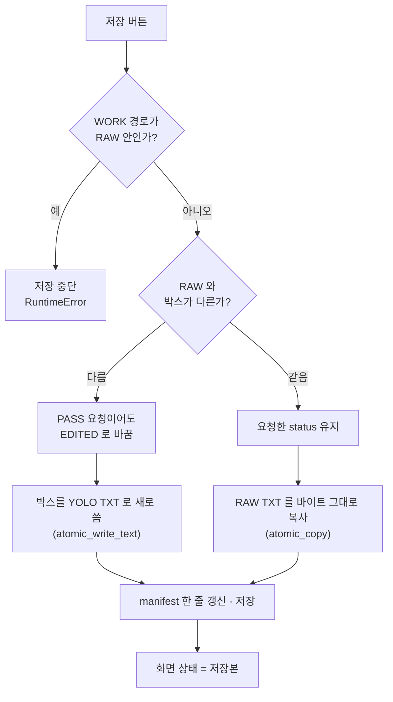
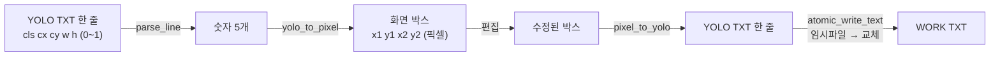
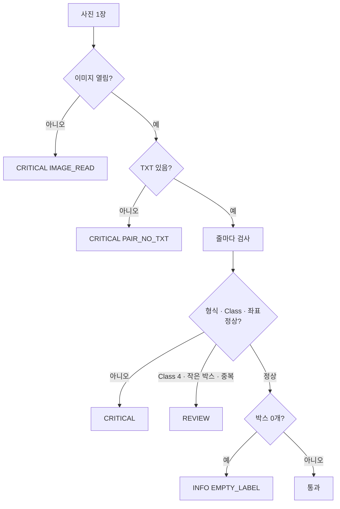
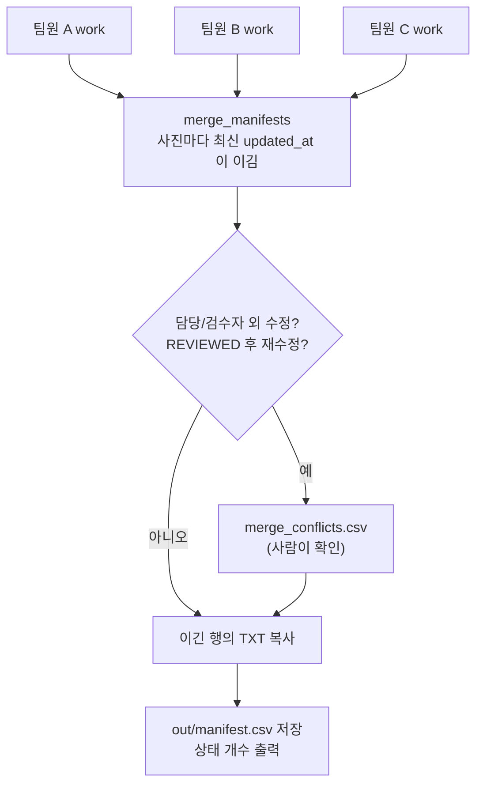
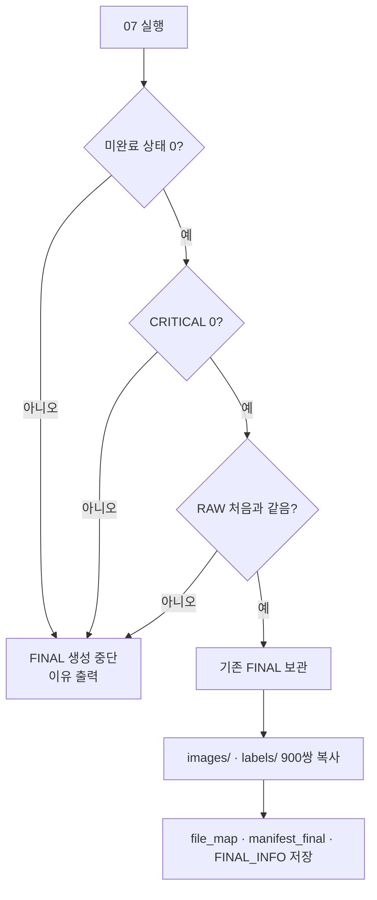

# 08 코드 리뷰 — 교과 7 라벨링 프로그램

> 📍 [README](../README.md) › docs › **08 코드 리뷰** · ← [07 팀 작업 기록](07_team_worklog.md) · → [09 코드 공부](09_code_study.md)
> 작성 PM · 2026-10-12 · 2026-10-15 역할별 코드 설명(구 CODE_GUIDE)과 합침

## 한눈에 보기

- 프로그램은 **4층**으로 나뉩니다: 화면(`src/ui`) → 규칙(`src/bbox/session.py`) → 데이터(`src/yolo` · `manifest`) → 파일(`data/work`)
- 가장 중요한 함수는 **`session.save`** — 원본 보호 · 상태 결정 · 안전 저장(임시 파일 → 교체)을 모두 여기서 합니다
- 화면 없이도 테스트할 수 있게 **화면과 규칙을 분리**했습니다 → `tests/test_core.py` 4개로 저장 · 좌표 · 전체 흐름 확인
- **Part A** = 핵심 파일 5개를 의사코드 → 처리흐름 → 흐름도(Mermaid) 순서로 리뷰 · **Part B** = 역할별로 어느 파일을 맡았는지
- 오류가 나면: 저장 문제 → A1 · 좌표 문제 → A2 · 검사 문제 → A3 · 합치기 문제 → A4 · FINAL 문제 → A5 (A0 = 전체 흐름)

---

# Part A — 핵심 코드 리뷰

> 작성: Sung Hyung Lee (PM) · 2026-10-12 · main e6ddb56 기준
> 방식: 교과 2 「코드리뷰를 효율적으로 하는 방법」 5단계 (왜 필요 → 주요 함수 → **데이터 흐름** → 실패 지점 → 연결)
> + 각 파일마다 **의사코드 → 처리흐름 → Mermaid** 순서로 정리
> 실제 데이터(JPG · TXT · manifest)는 이 문서에 넣지 않습니다.

### 목차
0. 전체 처리흐름 (스크립트 00 ~ 10 + 프로그램)
1. `src/bbox/session.py` — 저장 규칙 (`load` · `save`)
2. `src/yolo/yolo_io.py` — YOLO 좌표 변환 · 안전 저장
3. `src/validation/validator.py` — 라벨 검사 (`check_label_text` · `validate`)
4. `scripts/04_merge.py` + `src/manifest.py` — 팀원 작업 합치기
5. `scripts/07_build_final.py` — FINAL 생성 · Freeze
6. 리뷰 결과 요약 (확인된 것 · 남은 위험)

---

## A0. 전체 처리흐름

**한 줄 요약**: RAW 원본은 절대 고치지 않고, 모든 수정은 WORK 에 저장 → 합치기 → 검사 → 조건을 모두 만족할 때만 FINAL 생성.

### 의사코드
```text
RAW 스냅샷 저장 (00)                       # RAW 가 바뀌었는지 나중에 비교
manifest 생성 (01)                         # 900장 목록 + 출처 · split · 상태 PENDING
담당 배분 (03)                             # assignee / reviewer 칸 채움
반복 (매일):
    각자 프로그램에서 라벨 확인 · 수정 · 저장  # WORK 에만 저장
    17:20 각자 work zip 제출
    PM 이 합치기 (04)                       # 최신 updated_at 이 이김
    검사 (02)                               # CRITICAL / REVIEW / INFO
PASS 표본 검수 (06)
QA 요약 (05)
조건 확인 후 FINAL 생성 (07)                # REVIEW 0 · CRITICAL 0 · RAW 동일
교과 8 인계 (08)
```

### Mermaid


---

## A1. `src/bbox/session.py` — 저장 규칙

**왜 필요?** 화면(GUI)과 데이터 처리를 분리해서, 저장 규칙을 한 곳에서 지키기 위해. GUI 없이도 테스트 가능 (`tests/test_core.py`).

**주요 함수**

| 함수 | 하는 일 |
|---|---|
| `load(index)` | 사진 1장을 열고, WORK 저장본이 있으면 그것을 · 없으면 RAW 라벨을 보여줌. 이전 사진 상태는 완전히 버림 (BBox 잔상 방지) |
| `save(status, …)` | WORK 에 TXT 저장 + manifest 갱신. **RAW 는 절대 쓰지 않음** |
| `add_box` · `move_box` · `undo` | 편집 (원본 픽셀 좌표로만 저장) |

### 의사코드 — `save`
```text
save(status):
    work_path = 이 사진의 WORK TXT 경로
    만약 work_path 가 RAW 폴더 안이면 → 저장 중단 (RAW 보호)
    changed = 지금 박스가 RAW 박스와 다른가?
    만약 status 가 비었거나 PENDING/WORKING → changed 면 EDITED, 아니면 PASS
    만약 status 가 PASS 인데 changed → EDITED 로 바꿈     # 고쳤으면 PASS 아님
    만약 안 바뀜 → RAW TXT 를 바이트 그대로 복사         # 원문 보존
    아니면     → 박스를 YOLO 형식으로 새로 씀
    manifest 갱신: status · BBox 수 · Class 수 · 변화량 · note · issue · updated_by
    status 가 REVIEWED 면 reviewer = 나
    manifest 저장
    화면 상태를 '저장된 그대로'로 맞춤                   # Save/Reload 일관성
    실제 적용된 status 를 돌려줌
```

### 처리흐름
```text
화면 박스 (원본 픽셀 좌표)
  → RAW 와 비교 (changed?)
  → status 결정 (PASS / EDITED / REVIEW / REVIEWED)
  → WORK/labels/…/이름.txt   (안 바뀌면 RAW 복사 · 바뀌면 새로 씀)
  → WORK/manifest.csv 한 줄 갱신 (updated_at · updated_by 자동)
```

### Mermaid


**실패할 수 있는 곳**
- WORK 경로 설정이 RAW 를 가리킴 → 코드가 막음 (RuntimeError)
- RAW TXT 가 없는데 '안 바뀜' 으로 판정 → 복사할 원본이 없음 (빈 TXT 사진 확인 필요)
- 두 사람이 같은 사진 저장 → 합칠 때 최신 updated_at 이 이김 → 04 conflicts 보고서로 확인

**연결**: `ui/app.py` 저장 버튼 → `session.save` → `yolo_io` (파일 쓰기) · `manifest.py` (장부)

---

## A2. `src/yolo/yolo_io.py` — 좌표 변환 · 안전 저장

**왜 필요?** YOLO TXT 는 0~1 비율 좌표, 화면은 픽셀 좌표 → 변환이 틀리면 모든 라벨이 틀어짐. 저장 도중 꺼져도 TXT 가 깨지면 안 됨.

### 의사코드
```text
yolo_to_pixel(cls, cx, cy, w, h, 이미지 W, H):
    x1 = (cx - w/2) * W ;  y1 = (cy - h/2) * H
    x2 = (cx + w/2) * W ;  y2 = (cy + h/2) * H

pixel_to_yolo(박스, W, H):
    cx = 가운데 x / W ;  cy = 가운데 y / H
    w  = 너비 / W     ;  h  = 높이 / H
    → "cls cx cy w h" (소수 6자리)

parse_line(한 줄):
    값이 5개가 아니면 오류 · class 가 정수가 아니면 오류 · 숫자 변환 실패면 오류

atomic_write_text(경로, 글):
    같은 폴더 임시파일에 먼저 씀 → 다 쓰면 원래 이름으로 교체
    중간에 실패하면 임시파일 삭제 (원래 파일은 그대로)
```

### Mermaid


**실패할 수 있는 곳**: 값 4개 · 6개 줄, 문자 섞인 줄 → 오류 목록으로 남기고 그 줄만 건너뜀 · 이미지 크기를 잘못 읽으면 변환 전체가 틀어짐 (EXIF 회전 → validator 가 REVIEW 로 표시)

**연결**: `session.load/save`, `validator`, `07_build_final` 모두 이 파일을 사용

---

## A3. `src/validation/validator.py` — 라벨 검사

**왜 필요?** 900장을 사람이 다 볼 수 없으니, 형식 오류 · 범위 오류 · 짝 오류를 자동으로 찾아 FINAL 전에 막기 위해.

### 의사코드 — `validate`
```text
validate(RAW 목록, WORK 우선):
    각 사진마다:
        이미지 크기 읽기 실패 → CRITICAL IMAGE_READ
        EXIF 회전 있음 → REVIEW EXIF_ROTATE
        TXT 없음 → CRITICAL PAIR_NO_TXT
        TXT 각 줄 검사 (check_label_text):
            형식 오류 → CRITICAL PARSE
            class 0~6 밖 → CRITICAL CLASS_RANGE
            class 4 → REVIEW CLASS_4
            좌표 0~1 밖 · 너비/높이 0 · 이미지 밖 → CRITICAL
            아주 작은 박스 → REVIEW TINY_BOX
            같은 class 겹침 (IoU 높음) → REVIEW DUPLICATE
        박스 0개 → INFO EMPTY_LABEL (정상 김치인지 사람이 확인)
    JPG 없는 TXT → CRITICAL PAIR_NO_JPG
    manifest 상태가 REVIEW → REVIEW STATUS_REVIEW
    CRITICAL → REVIEW → INFO 순 정렬
```

### Mermaid


**실패할 수 있는 곳**: 빈 TXT 를 무조건 오류로 보면 정상 김치 사진을 잘못 막음 → INFO 로만 표시 (기준서와 같음) · Class 4 를 자동 삭제하면 안 됨 → REVIEW

**연결**: 프로그램 Validation 창 · `02_validate.py` · `07_build_final.py` (CRITICAL 1건이라도 있으면 FINAL 중단)

---

## A4. `scripts/04_merge.py` + `src/manifest.py` — 팀원 작업 합치기

**왜 필요?** 6명이 각자 PC 에서 작업 → 하루 끝에 하나의 WORK 로 모아야 다음 날 같은 상태에서 시작.

### 의사코드
```text
04_merge(--inputs 팀원 폴더들, --out 새 폴더):
    out 이 입력과 같거나 비어 있지 않으면 중단
    각 입력에 manifest.csv 없으면 중단
    merge_manifests:
        같은 사진은 (updated_at, 사람이 저장했는가) 가 더 큰 행이 이김
    동시 수정 의심 찾기:
        담당자/검수자가 아닌 사람이 고친 사진 → conflicts
        REVIEWED 이후 다시 고친 사진 → conflicts (재검수 필요)
    이긴 행의 TXT 를 out 으로 복사
    out/manifest.csv 저장 · reports/merge_conflicts.csv 저장
    상태 개수 출력
```

### Mermaid


**실패할 수 있는 곳**: 잘못된 zip(재배정본 등)을 넣으면 최신 시각이 이겨서 검수 결과가 덮일 수 있음 → 합치기 전 상태 · updated_by 숫자 확인 (10/12 실제 사례) · `--out` 에 기존 폴더 지정 → 코드가 막음

**연결**: 매일 17:20 제출 zip → 04 → 02 검사 → 배포

---

## A5. `scripts/07_build_final.py` — FINAL 생성 · Freeze

**왜 필요?** 교과 8 학습 입력이 되는 최종 900장을 **조건을 모두 만족할 때만** 한 번에 만들고, 이후 직접 수정을 막기 위해.

### 의사코드
```text
07_build_final():
    problems = []
    PENDING · WORKING · REVIEW · EDITED(교차검수 안 됨) 가 남았으면 → problems
    manifest 에 없는 사진이 있으면 → problems
    WORK 기준 Validation CRITICAL 이 있으면 → problems
    RAW 스냅샷이 있으면 RAW 가 처음과 같은지 확인 → 다르면 problems
    problems 가 하나라도 있으면 → 이유 출력 후 중단 (FINAL 안 만듦)
    기존 FINAL 이 있으면 _old_날짜 로 보관
    images/ · labels/ 에 같은 이름으로 복사 (출처 · split 은 file_map 에 기록)
    manifest_final.csv · FINAL_INFO.json 저장 · WORK manifest 도 FINAL 표시
```

### Mermaid


**실패할 수 있는 곳**: REVIEW 1장만 남아도 중단 (의도된 동작) · RAW 스냅샷이 없으면 RAW 확인을 건너뜀 (경고만) → 00 스냅샷 있는지 확인 필요

**연결**: 교과 8 `data/subject7_final/` 입력 · `08_handoff.py`

---

## A6. 리뷰 결과 요약

| 항목 | 결과 |
|---|---|
| RAW 보호 | ✅ session.save 가 RAW 안 저장을 막음 · 07 이 RAW 변경을 검사 |
| 고치면 PASS 불가 | ✅ PASS 요청 + 변경 → EDITED 자동 |
| 저장 중 꺼짐 | ✅ 임시파일 → 교체 (atomic) |
| FINAL 조건 | ✅ 미완료 · CRITICAL · RAW 변경 중 하나라도 있으면 중단 |
| 합치기 위험 | ⚠ 잘못된 입력 zip 은 코드가 못 막음 → 사람이 상태 숫자 확인 |
| 빈 TXT · Class 4 | ✅ 자동 오류 X · INFO / REVIEW 로 사람 확인 |
| 남은 할 일 | 강사님 형식 확인 후 보완 · 교과 8 코드도 같은 형식으로 `project8/docs/08_code_review.md` |


---

# Part B — 역할별 코드 지도

> 원칙: **화면(GUI)과 데이터 로직(session)을 분리**했습니다. 그래서 GUI 를 띄우지 않고도 `tests/test_core.py` 로 저장·좌표·병합·FINAL 을 자동으로 시험할 수 있습니다.
> 발표 때도 "어떤 함수가 어떤 문제를 막는가"를 설명할 수 있어야 합니다.

```text
main.py
  └─ ui/ (app.py 화면·키 / menubar.py 메뉴 / panels.py 배치)
        ├─ bbox/canvas_editor.py (이미지·BBox 그리기, 마우스 편집)
        └─ bbox/session.py (Load · 편집 · Save · 상태규칙)
              ├─ yolo/yolo_io.py          (TXT ↔ Box, 안전저장)
              ├─ bbox/view.py             (원본 ↔ 화면 좌표)  ← ui 가 직접 사용
              ├─ yolo/dataset.py          (RAW 조사, 경로 규칙)
              ├─ manifest.py              (CSV 기록, 병합)
              └─ validation/validator.py  (자동 검사)
scripts/00~10 → 위 모듈을 조합한 운영 도구
```

---

## B1. PM / Integrator: `config.py`, `main.py`, `scripts/03_assign.py`, `scripts/07_build_final.py`

**config.py**: 팀 기준(Baseline)을 코드로 Freeze 한 파일입니다.

```python
CLASS_NAMES = {0: "나뭇잎·종이류", ..., 4: "고무장갑(미사용)", ..., 6: "파·고추"}
UNUSED_CLASS_IDS = {4}                       # 사용 안 함 -> REVIEW
ACTIVE_CLASS_IDS = [0, 1, 2, 3, 5, 6]        # 새 BBox 에 쓸 수 있는 Class
FINAL_READY_STATUSES = {"PASS", "REVIEWED"}  # FINAL 로 갈 수 있는 상태
```

- `Paths.check_not_same()` : RAW 와 WORK 가 같거나 하나가 다른 하나 안에 있으면 실행을 막습니다. RAW 를 보호하는 첫 번째 장치입니다.

**03_assign.py**: 배분 방법입니다.
- Dataset/split 그룹마다 "현재 가장 적게 받은 사람"에게 한 장씩 줍니다. 그래서 모두가 고르게 섞인 데이터를 받습니다.
- 검수자는 `workers[i+1]` 입니다 (A→B→…→F→A). 자기 작업을 자기가 검수할 수 없습니다.
- Pilot 은 (Dataset, split, 빈TXT / 단일 / 다중BBox) 버킷을 돌아가며 뽑습니다.

**07_build_final.py**: 다음 조건을 하나라도 어기면 FINAL 을 만들지 않습니다 (Gate 를 코드로 구현).
`FINAL 불가 상태 0` + `CRITICAL 0` + `RAW 해시 동일`

---

## B2. GUI / Image: `src/ui/`, `src/bbox/canvas_editor.py`

| 파일 | 하는 일 |
|---|---|
| `app.py` | 메인 창 `LabelApp`. 메뉴 구성, 단축키, 이미지 이동, 저장, 통계 메뉴 동작, `run()` |
| `panels.py` | 위젯 배치만 담당 (왼쪽 목록, 가운데 Canvas, 오른쪽 두 열, 아래 도구 막대) |
| `canvas_editor.py` | 이미지 그리기(피라미드, 보이는 영역만 crop)와 BBox 그리기·마우스 편집 |
| `menubar.py` | 직접 만든 메뉴 막대. 드롭다운은 메인 창 안의 Frame 이라 잔상이 없고, 항상 하나만 열립니다 |
| `dialogs.py` | Validation 결과 표, 진행현황, Class 통계, 단축키 안내 창 |
| `style.py` | 색, 글꼴, 상태 기호, 버튼/테두리 만드는 함수 |

| 부분 | 핵심 |
|---|---|
| `goto()` | 이동 전 `confirm_leave()` 로 저장 안 된 변경 확인 → `session.load()` → 이미지 피라미드 생성 → `fit()` |
| `make_pyramid()` | 4K 원본, 1/2, 1/4 크기를 미리 만들어 둡니다. 배율이 낮을 때는 작은 것을 써서 빠르게 그립니다 |
| `render()` | **보이는 영역만** 잘라서(crop) 확대/축소합니다. 4K 전체를 매번 리사이즈하지 않습니다 |
| `draw_boxes()` | Box(원본 좌표) → `view.to_canvas()` → 사각형. Class 별 색, 선택 시 굵게, Class 4 는 점선 |
| `bind_keys()` | Entry 에 글자를 입력할 때는 단축키를 무시합니다 (`guard`) |
| `on_left_down/drag/up()` | 모드(draw/select/pan)와 `drag` 딕셔너리로 그리기·이동·크기조절을 구분. 드래그 시작 때 1번만 Undo 지점 (`session.begin_edit`) |
| `hit_handle()` | 선택 BBox 의 8개 핸들 중 마우스 근처(7px) 핸들 찾기 |
| `apply_box_entries()` | 오른쪽 칸의 YOLO 좌표 → 픽셀 → `session.replace_box()` |
| `refresh_image_list()` | 왼쪽 목록을 Manifest 상태 색/기호로 다시 그림, 저장하면 해당 줄만 갱신 |
| 버튼 `takefocus=0` | 버튼이 포커스를 가져가 Space 가 버튼을 누르는 문제를 막습니다 |

이미지 전환 때 이전 BBox 가 남지 않는 이유: `session.load()` 가 `LoadedImage` 를 **새로 만들기** 때문입니다. 이전 상태를 고쳐 쓰지 않습니다.

### 메뉴 잔상 문제와 `menubar.py`

`tk.Menu` 로 만든 메뉴는 WSL(WSLg) 화면에서 한 메뉴를 연 채 다른 메뉴로 마우스를 옮기면 이전 드롭다운이 잔상으로 남았습니다.
`tk.Menu` 의 드롭다운은 메인 창과 별개인 작은 창인데, WSLg 가 그 창이 닫힌 자리를 제때 다시 그려 주지 않기 때문입니다. (드롭다운을 새 창으로 만들고 `destroy()` 해도 잔상이 남았습니다.)

- 드롭다운을 별도 창으로 만들지 않고, 메인 창 안에 `Frame` 을 `place()` 로 띄웠다가 `destroy()` 합니다. 메인 창이 직접 다시 그리므로 잔상이 생기지 않습니다.
- 다른 메뉴 제목에 마우스가 올라가면 열린 메뉴를 먼저 없애고 새 메뉴를 엽니다. 메뉴는 항상 하나만 열려 있습니다.
- 메뉴 바깥 클릭, `Esc`, 창 이동·최소화, 다른 프로그램으로 전환할 때도 닫힙니다.
- 메뉴가 열려 있을 때 바깥을 누르면 **메뉴만 닫히고** 그 클릭은 무시됩니다 (`CLICK_GUARD` bindtag). 메뉴를 닫으려다 이미지 목록이 바뀌거나 버튼이 눌리는 일을 막습니다.
- 옆 메뉴로 마우스를 옮겨 열린 메뉴를 바로 클릭해도 닫히지 않습니다 (`opened_by_hover`).
- 키보드: `Alt+F/V/T/Q/S/H`, `F10` 으로 열고 `↑↓←→`, `Enter`, `Esc` 로 움직입니다. 메뉴가 열려 있는 동안에는 A, D, Space 같은 단축키가 눌리지 않습니다.

---

## B3. BBox / Coordinate: `src/bbox/view.py`, `yolo_io.py` 의 변환 함수

```python
# 원본 → 화면
canvas_x = image_x * scale + offset_x
# 화면 → 원본
image_x = (canvas_x - offset_x) / scale
```

- **BBox 는 항상 원본 픽셀 좌표로 저장합니다.** 화면에 그릴 때만 변환하므로 Zoom/Pan 을 해도 실제 위치는 변하지 않습니다.
- `zoom_at(factor, cx, cy)` 는 마우스 아래 이미지 점을 먼저 구하고, 배율을 바꾼 뒤 그 점이 같은 화면 위치에 오도록 offset 을 다시 계산합니다.

```python
ix, iy = self.to_image(cx, cy)
self.scale = new_scale
self.offset_x = cx - ix * new_scale
```

- YOLO ↔ 픽셀 변환:

```python
x1 = (cx - w/2) * img_w ;  x2 = (cx + w/2) * img_w        # yolo_to_pixel
cx = (x1 + x2) / 2 / img_w ;  w = (x2 - x1) / img_w        # pixel_to_yolo
```

- `Box.clamp()` 는 이미지 밖으로 나간 부분을 잘라냅니다. `MIN_BOX_PX` 보다 작은 박스는 만들지 않습니다 (실수 드래그 방지).
- 검증: `09_golden_test.py` 가 여러 Zoom/Pan 상태에서 왕복 오차 < 1e-6 인지 확인합니다.

---

## B4. Label / Storage: `src/yolo/yolo_io.py`, `src/bbox/session.py`

**파싱** `parse_line()` 은 값 5개, 숫자 변환, class 정수 여부를 확인하고 실패하면 오류 메시지를 돌려줍니다. 자동으로 고치지 않습니다.

**안전저장** `atomic_write_text()`

```python
fd, tmp = tempfile.mkstemp(dir=path.parent)   # 같은 폴더에 임시파일
write(tmp) -> os.replace(tmp, path)            # 한 번에 교체 -> 중간에 꺼져도 TXT 안 깨짐
```

**저장 규칙** `LabelSession.save()`

1. WORK 경로가 RAW 안이면 즉시 중단합니다.
2. `changed_vs_raw()` 가 참인데 PASS 를 요청하면 → EDITED 로 바꿉니다.
3. 라벨이 RAW 와 같으면 RAW 원문을 **그대로 복사**합니다 (소수점 형식까지 보존).
4. Manifest 에 status, final_bbox_count, scene_type, note, 작업자, 시간을 기록합니다.

**경로 규칙** `dataset.image_rel_to_label_rel()`
`.../images/train/a.jpg` → `.../labels/train/a.txt`. 키는 **파일명이 아니라 RAW 기준 상대경로**입니다 (Dataset1 과 2 에 같은 파일명이 있어도 안전).

---

## B5. QA / Validation: `src/validation/validator.py`, `scripts/02`, `06`, `09`, `00`

| 코드 | 심각도 | 의미 |
|---|---|---|
| PAIR_NO_TXT / PAIR_NO_JPG | CRITICAL | 짝 없음 |
| PARSE | CRITICAL | 값 개수나 숫자 형식 오류 |
| CLASS_RANGE | CRITICAL | 0~6 밖 |
| COORD_RANGE / WH_ZERO / BOX_OUTSIDE | CRITICAL | 좌표 범위·경계 오류 |
| IMAGE_READ | CRITICAL | 이미지가 안 열림 |
| CLASS_4 | REVIEW | 미사용 Class |
| DUPLICATE | REVIEW | 같은 Class 이고 IoU ≥ 0.9 |
| TINY_BOX | REVIEW | 3px 미만 |
| EXIF_ROTATE | REVIEW | 사진 회전 정보가 있어 좌표가 어긋날 수 있음 |
| EMPTY_LABEL | INFO | BBox 0개 (정상 이미지인지 사람이 확인) |

- `image_size()` 는 이미지 헤더만 읽어서 900장도 빠르게 검사합니다.
- `00_raw_snapshot.py` 는 SHA-256 으로 RAW 가 1바이트라도 바뀌었는지 확인합니다.
- `06_pass_sample.py` 는 PASS 중 절반을 위험도(작은 BBox, BBox 수, 희소 Class) 순으로, 절반을 무작위로 뽑습니다.

---

## B6. Data / Document: `src/manifest.py`, `manifest_builder.py`, `stats.py`, `scripts/01`, `04`, `05`, `08`

- Manifest 는 `utf-8-sig` 로 저장해서 엑셀에서 한글이 깨지지 않습니다.
- **병합** `merge_manifests()`: 같은 이미지는 `updated_at` 이 최신인 행을 씁니다. 시각이 같으면 사람이 작업한 행이 우선입니다. 라벨 파일도 그 행을 쓴 사람의 WORK 에서 가져옵니다.
- `04_merge.py` 는 담당/검수자가 아닌 사람이 수정했거나, REVIEWED 이후 다시 수정된 경우를 `reports/merge_conflicts.csv` 에 남깁니다.
- `stats.diff_boxes()`: RAW 와 최종 BBox 를 IoU 0.5 이상으로 짝지어 **유지 / 위치수정 / Class변경 / 추가 / 삭제** 수를 셉니다. QA Summary 와 Handoff 의 핵심 숫자입니다.

---

## B7. 하루 마감 루틴

```text
각자: 프로그램 종료(저장 확인) → 자기 data/work 폴더를 공유폴더 work_<이름> 으로 복사
Data: python scripts/04_merge.py --inputs work_A ... work_F --out work_merged_1014
QA  : python scripts/02_validate.py --work work_merged_1014
      python scripts/00_raw_snapshot.py --verify
Doc : python scripts/05_qa_summary.py --work work_merged_1014
PM  : QA_Summary 확인 → 다음 날 아침 work_merged 를 모두에게 배포 (각자 data/work 로 교체)
```

## B8. 직접 고쳐보며 공부할 과제

| 역할 | 과제 |
|---|---|
| GUI | 상태별 색으로 진행 위치 표시 / 썸네일 목록 |
| 좌표 | 방향키로 선택 BBox 1px 미세 이동 |
| 저장 | 저장 시 `.bak` 백업 1개 유지 옵션 |
| QA | Validation 결과를 심각도별로 필터링 |
| Data | scene_type 별 Class 분포 표를 QA Summary 에 추가 (`stats.scene_class` 사용) |
| PM | `tests/test_core.py` 에 새 테스트 1개씩 추가하는 규칙 운영 |

> Feature Freeze(10/13) 이후에는 위 과제를 본 작업 프로그램에 넣지 말고 **별도 브랜치**에서만 실습합니다.
