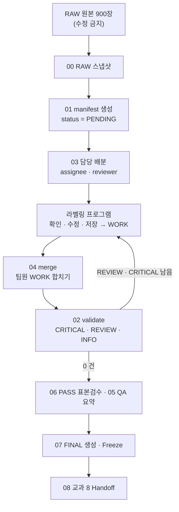
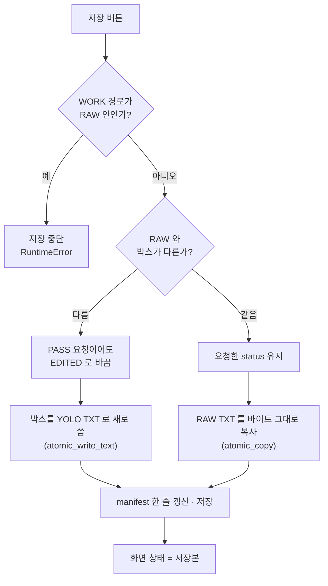
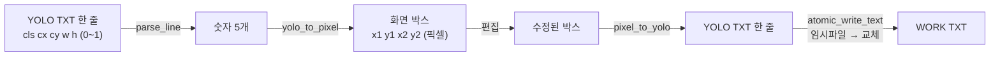
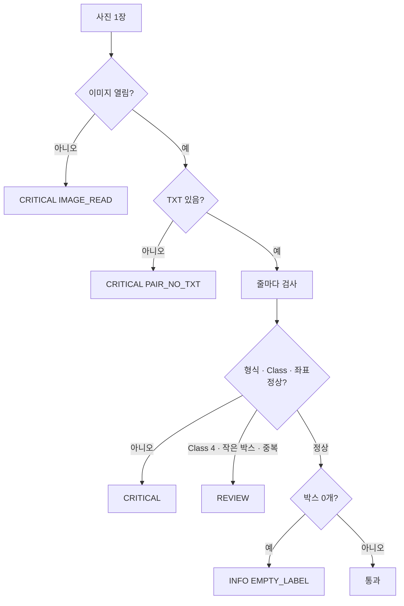
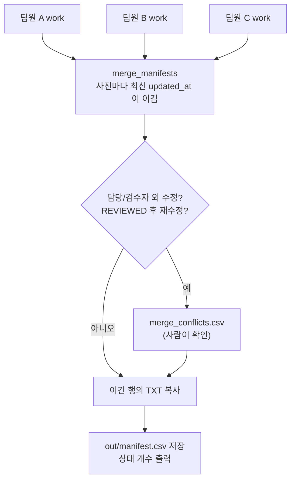
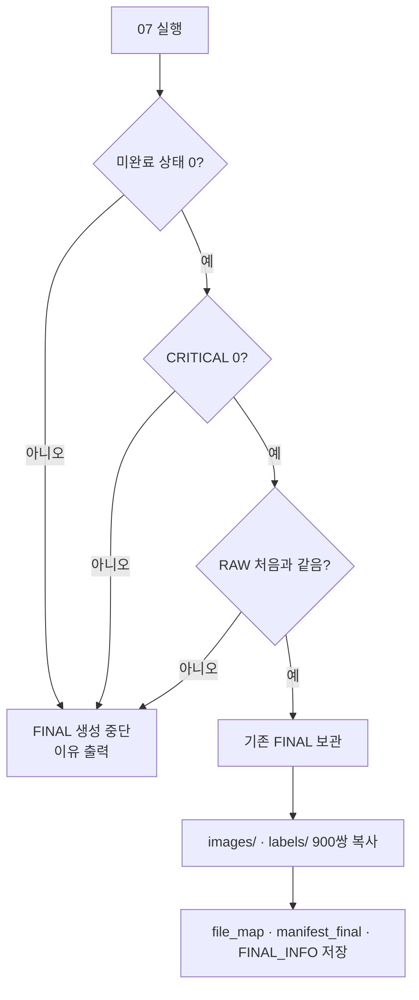

# 코드 리뷰 — kimchi_labeler (교과 7) · 초안 v1

> 작성: Sung Hyung Lee (PM) · 2026-10-12 · main e6ddb56 기준
> 방식: 교과 2 「코드리뷰를 효율적으로 하는 방법」 5단계 (왜 필요 → 주요 함수 → **데이터 흐름** → 실패 지점 → 연결)
> + 각 파일마다 **의사코드 → 처리흐름 → Mermaid** 순서로 정리
> ⚠ 초안입니다. 강사님 리뷰 형식 안내를 받으면 형식에 맞춰 업데이트합니다.
> 실제 데이터(JPG · TXT · manifest)는 이 문서에 넣지 않습니다.

## 목차
0. 전체 처리흐름 (스크립트 00 ~ 10 + 프로그램)
1. `src/bbox/session.py` — 저장 규칙 (`load` · `save`)
2. `src/yolo/yolo_io.py` — YOLO 좌표 변환 · 안전 저장
3. `src/validation/validator.py` — 라벨 검사 (`check_label_text` · `validate`)
4. `scripts/04_merge.py` + `src/manifest.py` — 팀원 작업 합치기
5. `scripts/07_build_final.py` — FINAL 생성 · Freeze
6. 리뷰 결과 요약 (확인된 것 · 남은 위험)

---

## 0. 전체 처리흐름

**한 줄 요약**: RAW 원본은 절대 고치지 않고, 모든 수정은 WORK 에 저장 → 합치기 → 검사 → 조건을 모두 만족할 때만 FINAL 생성.

### 의사코드
```text
RAW 스냅샷 저장 (00)                       # RAW 가 바뀌었는지 나중에 비교
manifest 생성 (01)                         # 900장 목록 + 출처 · split · 상태 PENDING
담당 배분 (03)                             # assignee / reviewer 칸 채움
반복 (매일):
    각자 프로그램에서 라벨 확인 · 수정 · 저장  # WORK 에만 저장
    17:20 각자 work zip 제출
    PM 이 합치기 (04)                       # 최신 updated_at 이 이김
    검사 (02)                               # CRITICAL / REVIEW / INFO
PASS 표본 검수 (06)
QA 요약 (05)
조건 확인 후 FINAL 생성 (07)                # REVIEW 0 · CRITICAL 0 · RAW 동일
교과 8 인계 (08)
```

### Mermaid


---

## 1. `src/bbox/session.py` — 저장 규칙

**왜 필요?** 화면(GUI)과 데이터 처리를 분리해서, 저장 규칙을 한 곳에서 지키기 위해. GUI 없이도 테스트 가능 (`tests/test_core.py`).

**주요 함수**

| 함수 | 하는 일 |
|---|---|
| `load(index)` | 사진 1장을 열고, WORK 저장본이 있으면 그것을 · 없으면 RAW 라벨을 보여줌. 이전 사진 상태는 완전히 버림 (BBox 잔상 방지) |
| `save(status, …)` | WORK 에 TXT 저장 + manifest 갱신. **RAW 는 절대 쓰지 않음** |
| `add_box` · `move_box` · `undo` | 편집 (원본 픽셀 좌표로만 저장) |

### 의사코드 — `save`
```text
save(status):
    work_path = 이 사진의 WORK TXT 경로
    만약 work_path 가 RAW 폴더 안이면 → 저장 중단 (RAW 보호)
    changed = 지금 박스가 RAW 박스와 다른가?
    만약 status 가 비었거나 PENDING/WORKING → changed 면 EDITED, 아니면 PASS
    만약 status 가 PASS 인데 changed → EDITED 로 바꿈     # 고쳤으면 PASS 아님
    만약 안 바뀜 → RAW TXT 를 바이트 그대로 복사         # 원문 보존
    아니면     → 박스를 YOLO 형식으로 새로 씀
    manifest 갱신: status · BBox 수 · Class 수 · 변화량 · note · issue · updated_by
    status 가 REVIEWED 면 reviewer = 나
    manifest 저장
    화면 상태를 '저장된 그대로'로 맞춤                   # Save/Reload 일관성
    실제 적용된 status 를 돌려줌
```

### 처리흐름 (데이터가 어떻게 바뀌나)
```text
화면 박스 (원본 픽셀 좌표)
  → RAW 와 비교 (changed?)
  → status 결정 (PASS / EDITED / REVIEW / REVIEWED)
  → WORK/labels/…/이름.txt   (안 바뀌면 RAW 복사 · 바뀌면 새로 씀)
  → WORK/manifest.csv 한 줄 갱신 (updated_at · updated_by 자동)
```

### Mermaid


**실패할 수 있는 곳**
- WORK 경로 설정이 RAW 를 가리킴 → 코드가 막음 (RuntimeError)
- RAW TXT 가 없는데 '안 바뀜' 으로 판정 → 복사할 원본이 없음 (빈 TXT 사진 확인 필요)
- 두 사람이 같은 사진 저장 → 합칠 때 최신 updated_at 이 이김 → 04 conflicts 보고서로 확인

**연결**: `ui/app.py` 저장 버튼 → `session.save` → `yolo_io` (파일 쓰기) · `manifest.py` (장부)

---

## 2. `src/yolo/yolo_io.py` — 좌표 변환 · 안전 저장

**왜 필요?** YOLO TXT 는 0~1 비율 좌표, 화면은 픽셀 좌표 → 변환이 틀리면 모든 라벨이 틀어짐. 저장 도중 꺼져도 TXT 가 깨지면 안 됨.

### 의사코드
```text
yolo_to_pixel(cls, cx, cy, w, h, 이미지 W, H):
    x1 = (cx - w/2) * W ;  y1 = (cy - h/2) * H
    x2 = (cx + w/2) * W ;  y2 = (cy + h/2) * H

pixel_to_yolo(박스, W, H):
    cx = 가운데 x / W ;  cy = 가운데 y / H
    w  = 너비 / W     ;  h  = 높이 / H
    → "cls cx cy w h" (소수 6자리)

parse_line(한 줄):
    값이 5개가 아니면 오류 · class 가 정수가 아니면 오류 · 숫자 변환 실패면 오류

atomic_write_text(경로, 글):
    같은 폴더 임시파일에 먼저 씀 → 다 쓰면 원래 이름으로 교체
    중간에 실패하면 임시파일 삭제 (원래 파일은 그대로)
```

### Mermaid


**실패할 수 있는 곳**: 값 4개 · 6개 줄, 문자 섞인 줄 → 오류 목록으로 남기고 그 줄만 건너뜀 · 이미지 크기를 잘못 읽으면 변환 전체가 틀어짐 (EXIF 회전 → validator 가 REVIEW 로 표시)

**연결**: `session.load/save`, `validator`, `07_build_final` 모두 이 파일을 사용

---

## 3. `src/validation/validator.py` — 라벨 검사

**왜 필요?** 900장을 사람이 다 볼 수 없으니, 형식 오류 · 범위 오류 · 짝 오류를 자동으로 찾아 FINAL 전에 막기 위해.

### 의사코드 — `validate`
```text
validate(RAW 목록, WORK 우선):
    각 사진마다:
        이미지 크기 읽기 실패 → CRITICAL IMAGE_READ
        EXIF 회전 있음 → REVIEW EXIF_ROTATE
        TXT 없음 → CRITICAL PAIR_NO_TXT
        TXT 각 줄 검사 (check_label_text):
            형식 오류 → CRITICAL PARSE
            class 0~6 밖 → CRITICAL CLASS_RANGE
            class 4 → REVIEW CLASS_4
            좌표 0~1 밖 · 너비/높이 0 · 이미지 밖 → CRITICAL
            아주 작은 박스 → REVIEW TINY_BOX
            같은 class 겹침 (IoU 높음) → REVIEW DUPLICATE
        박스 0개 → INFO EMPTY_LABEL (정상 김치인지 사람이 확인)
    JPG 없는 TXT → CRITICAL PAIR_NO_JPG
    manifest 상태가 REVIEW → REVIEW STATUS_REVIEW
    CRITICAL → REVIEW → INFO 순 정렬
```

### Mermaid


**실패할 수 있는 곳**: 빈 TXT 를 무조건 오류로 보면 정상 김치 사진을 잘못 막음 → INFO 로만 표시 (기준서와 같음) · Class 4 를 자동 삭제하면 안 됨 → REVIEW

**연결**: 프로그램 Validation 창 · `02_validate.py` · `07_build_final.py` (CRITICAL 1건이라도 있으면 FINAL 중단)

---

## 4. `scripts/04_merge.py` + `src/manifest.py` — 팀원 작업 합치기

**왜 필요?** 6명이 각자 PC 에서 작업 → 하루 끝에 하나의 WORK 로 모아야 다음 날 같은 상태에서 시작.

### 의사코드
```text
04_merge(--inputs 팀원 폴더들, --out 새 폴더):
    out 이 입력과 같거나 비어 있지 않으면 중단
    각 입력에 manifest.csv 없으면 중단
    merge_manifests:
        같은 사진은 (updated_at, 사람이 저장했는가) 가 더 큰 행이 이김
    동시 수정 의심 찾기:
        담당자/검수자가 아닌 사람이 고친 사진 → conflicts
        REVIEWED 이후 다시 고친 사진 → conflicts (재검수 필요)
    이긴 행의 TXT 를 out 으로 복사
    out/manifest.csv 저장 · reports/merge_conflicts.csv 저장
    상태 개수 출력
```

### Mermaid


**실패할 수 있는 곳**: 잘못된 zip(재배정본 등)을 넣으면 최신 시각이 이겨서 검수 결과가 덮일 수 있음 → 합치기 전 상태 · updated_by 숫자 확인 (10/12 실제 사례) · `--out` 에 기존 폴더 지정 → 코드가 막음

**연결**: 매일 17:20 제출 zip → 04 → 02 검사 → 배포

---

## 5. `scripts/07_build_final.py` — FINAL 생성 · Freeze

**왜 필요?** 교과 8 학습 입력이 되는 최종 900장을 **조건을 모두 만족할 때만** 한 번에 만들고, 이후 직접 수정을 막기 위해.

### 의사코드
```text
07_build_final():
    problems = []
    PENDING · WORKING · REVIEW · EDITED(교차검수 안 됨) 가 남았으면 → problems
    manifest 에 없는 사진이 있으면 → problems
    WORK 기준 Validation CRITICAL 이 있으면 → problems
    RAW 스냅샷이 있으면 RAW 가 처음과 같은지 확인 → 다르면 problems
    problems 가 하나라도 있으면 → 이유 출력 후 중단 (FINAL 안 만듦)
    기존 FINAL 이 있으면 _old_날짜 로 보관
    images/ · labels/ 에 같은 이름으로 복사 (출처 · split 은 file_map 에 기록)
    manifest_final.csv · FINAL_INFO.json 저장 · WORK manifest 도 FINAL 표시
```

### Mermaid


**실패할 수 있는 곳**: REVIEW 1장만 남아도 중단 (의도된 동작) · RAW 스냅샷이 없으면 RAW 확인을 건너뜀 (경고만) → 00 스냅샷 있는지 확인 필요

**연결**: 교과 8 `data/subject7_final/` 입력 · `08_handoff.py`

---

## 6. 리뷰 결과 요약

| 항목 | 결과 |
|---|---|
| RAW 보호 | ✅ session.save 가 RAW 안 저장을 막음 · 07 이 RAW 변경을 검사 |
| 고치면 PASS 불가 | ✅ PASS 요청 + 변경 → EDITED 자동 |
| 저장 중 꺼짐 | ✅ 임시파일 → 교체 (atomic) |
| FINAL 조건 | ✅ 미완료 · CRITICAL · RAW 변경 중 하나라도 있으면 중단 |
| 합치기 위험 | ⚠ 잘못된 입력 zip 은 코드가 못 막음 → 사람이 상태 숫자 확인 |
| 빈 TXT · Class 4 | ✅ 자동 오류 X · INFO / REVIEW 로 사람 확인 |
| 남은 할 일 | 강사님 형식 확인 후 보완 · 교과 8 코드도 같은 형식으로 `project8/docs/code_review.md` |
