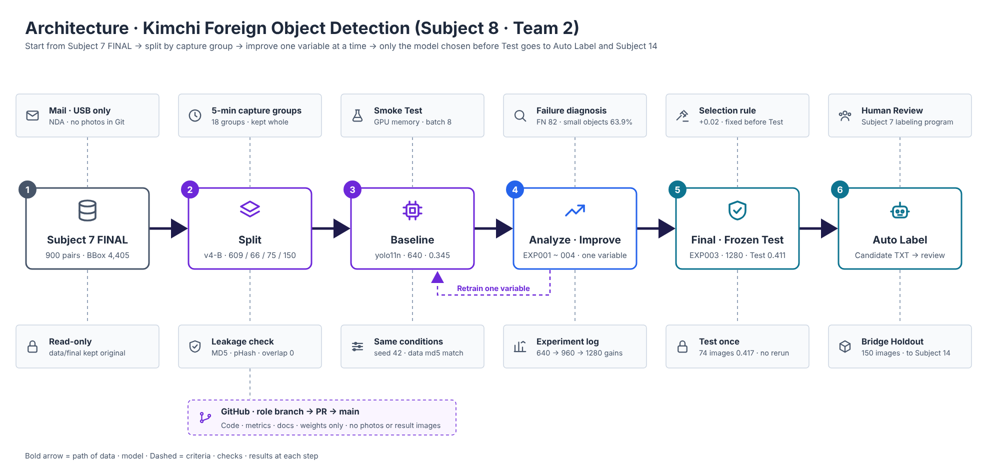

# Kimchi Foreign Object Detection — YOLO11

<p align="right"><a href="README.md">한국어</a> | <b>English</b></p>

## Project Overview

### Architecture

We split the Subject 7 FINAL 900 pairs **by 5-minute capture group** and improve from the Baseline by changing **one variable at a time**. Only the Final Model chosen **before looking at the Frozen Test** goes on to Auto Label and Subject 14.



<br>

### Summary

This is a Team 2 project on detecting foreign objects in cut kimchi. We train YOLO11 on the **FINAL 900 pairs** fully reviewed in Subject 7 and carry it through **failure analysis → one-variable improvement → Final Model → Frozen Test → Auto Label**.

The goal is **trustworthy data**, not a high score. We rebuilt the Split so images from the same capture group never mix between training and evaluation, changed one variable per experiment, and fixed the Final Model **before looking at the Frozen Test**.

<br>

### Results

The Baseline missed **63.9%** of small objects. Based on the hypothesis that "shrinking to 640 makes small objects disappear," we increased only the image size, the score rose step by step, and we chose **EXP003 (yolo11n · 1280)** as the Final Model.

| Key metric | Result |
|---|---|
| Data | FINAL **900 pairs** → Train 609 · Val 66 · Test 75 · Bridge 150 |
| Baseline | yolo11n · 640 · Val mAP50-95 **0.345** |
| Final Model | **EXP003** yolo11n · 1280 · Val mAP50-95 **0.446 (+29%)** |
| Frozen Test | Once · mAP50-95 **0.4115** (75 images) |
| Speed | About 26 GFLOPs · **8.7 ms** inference per image on an RTX 3060 |

Evidence → [Final Model Selection (Korean)](reports/final_model_selection.md) · [Baseline vs Improved (Korean)](reports/baseline_vs_improved.md)

<br>

### Limitations

The score went up, but some problems are clearly still unsolved. We don't hide them; we pass on the causes and next steps.

| Limitation | Details |
|---|---|
| Disease · browning Recall **0** | 46% of this class sits in the Bridge groups, so there was too little to train on → a **data problem**, not a model problem · reshoot in Subject 11 |
| **60%** of small objects missed | Resolution alone improved it only from 63.9% → 60.2% · EXP004, which also enlarges the model, reaches 49.4% |
| Evaluation size | Val 66 images · 1 seed · green onion · pepper has only 1 object each in Val · Test, so it cannot be evaluated |
| Speed | 1280 needs about 4× the computation of the Baseline · real device (Jetson) speed will be checked in Subject 14 |

Details → [13. Known Limitations](#limits)

<br>

### Deliverables

| No. | Deliverable | Location | Status |
|---:|---|---|---|
| 1 | Dataset Version | `configs/` · `manifests/` · [split_policy](docs/split_policy.md) | Done · kimchi_v4 |
| 2 | Baseline Model | `models/baseline/` · [baseline_metrics](reports/baseline_metrics.csv) | Done |
| 3 | Failure Analysis | [failure_analysis](reports/failure_analysis.csv) · `demo/failure_analysis/` | Done |
| 4 | Improved / Final Model | `models/improved/` · `models/final/` · [selection](reports/final_model_selection.md) | Done · EXP003 |
| 5 | Performance · experiment log | [experiment_log](reports/experiment_log.csv) · [final_metrics](reports/final_metrics.csv) · [figures](reports/figures) | Done |
| 6 | Detection · Auto Label | `demo/prediction_images/` · `demo/auto_label/` · [auto_label_review](reports/auto_label_review.csv) | Done · 1 demo image |
| 7 | Docs · Subject 14 link | README · `reports/acceptance_test.md` · `docs/handoff_subject14.md` | In progress |
| 8 | Presentation · demo | `presentation/` · `demo/*.mp4` | In progress |

<br>

### Team

| Role | Name | Responsibilities | Branch | Main deliverables |
|---|---|---|---|---|
| PM | Sung&nbsp;Hyung&nbsp;Lee | Project lead · schedule · Split · evaluation criteria · Final Model decision · GitHub management · presentation lead | feature/pm | README · Architecture · Acceptance Test · presentation |
| Data | Sehun&nbsp;Jang | Dataset Audit · Split · leakage check | feature/dataset‑audit | Split v4-B · manifests |
| Training | Sangjik&nbsp;Lee | Smoke Test · Baseline training | feature/train | Baseline Model |
| Evaluation | Hana&nbsp;Park | Evaluation module · failure analysis · Frozen Test | feature/evaluation | Failure Analysis · Final Test |
| Experiment | Hasol&nbsp;Park | One-variable improvement experiments · Final selection | feature/experiment | EXP001 ~ 004 · Final Model |
| Inference | Junhyung&nbsp;Kim | Detection · Auto Label · Human Review | feature/inference | candidate · reviewed labels |

<br>

### Quick Links

| Purpose | Link |
|---|---|
| First run | [Quick Start](#quick-start) → [4. How to Run](#run) |
| Results · evidence | [10. Improvement](#improvement) · [11. Final Test](#final-test) |
| Limitations · next steps | [13. Known Limitations](#limits) · [14. Subject 14 Handoff](#handoff) |

<br><br>

## Quick Start

You need: Windows 11 + WSL2 Ubuntu · an NVIDIA GPU (without one it runs slowly on CPU). Installing WSL · Git is the same as step 1 of the [Subject 7 Quick Start](../project7/README.en.md#quick-start).

**Step 1 · Clone · install** — run in the Ubuntu window

```bash
git clone https://github.com/sunghyunglee6334-web/group2-project.git ~/group2_project
cd ~/group2_project/project8
python3 -m venv .venv && source .venv/bin/activate
pip install -r requirements.txt pytest
```

**Step 2 · Check** — environment check and automated tests

```bash
python scripts/01_check_environment.py
python -m pytest tests/ -q
```

You're done when you see `YOLO load OK` and `87 passed`. On a GPU PC, `CUDA available: True` also appears.

**Step 3 · Detection · Auto Label demo** — runs right away with the Final Model that comes with Git (`models/final/final_best.pt`); no retraining needed

```bash
mkdir -p data/test_detection
python scripts/14_predict_images.py --output demo/quickstart
python scripts/15_auto_label.py --output-dir demo/quickstart/labels --results demo/quickstart/labels/auto_label_results.csv
git restore reports/auto_label_review.csv
```

Put one demo image into `data/test_detection/` and run (training · evaluation images are blocked). You're done when detection result images and candidate TXTs appear in `demo/quickstart/`; the candidate TXTs are confirmed by Human Review in the Subject 7 program → [12. Auto Label](#auto-label) · for training · evaluation, get the FINAL 900 pairs first, then see [4. How to Run](#run)

<br><br>

<a id="data"></a>
<details>
<summary><b>1. Data</b> — FINAL 900 pairs · 4848 × 2704 · scene mix · kimchi_v4 · data location</summary>

- Input: Subject 7 **FINAL 900 pairs** (900 JPG · 900 YOLO TXT · 4,405 BBoxes) → [Subject 8 Handoff (Korean)](../project7/docs/10_subject08_handoff.md)
- Originals: 4848 × 2704 · **100% synthetic** educational data from AI Campus · **under NDA**
- Scenes: kimchi + foreign objects 725 · foreign objects only 149 · normal kimchi 24 · no objects 2
- Dataset Version: **kimchi_v4**

| Location | Contents | Git |
|---|---|---|
| `data/final/` | Subject 7 FINAL 900 pairs · received by mail · USB | Excluded |
| `data/yolo/` | train · val · test (made by 03_build_split) | Excluded |
| `data/bridge_holdout/` | 150 images for Subject 14 · not used for training · evaluation | Excluded |

</details>

<a id="classes"></a>
<details>
<summary><b>2. Class</b> — Class 0~6 · Train / Val / Test counts · rubber gloves as background · green onion · pepper not evaluable</summary>

Same numbers as Subject 7 · **do not renumber** · settings [configs/dataset.yaml](configs/dataset.yaml)

| Class | Name | Train | Val | Test |
|---:|---|---:|---:|---:|
| 0 | Leaves · paper | 489 | 27 | 14 |
| 1 | Plastic · stone · metal | 1,019 | 145 | 181 |
| 2 | Twigs | 673 | 39 | 177 |
| 3 | Insects | 323 | 23 | 10 |
| 4 | Rubber glove — unused · background | 0 | 0 | 0 |
| 5 | Disease · browning | 163 | 21 | 45 |
| 6 | Green onion · pepper | 249 | 1 | 1 |

- **Kimchi · rubber gloves = background** · green onion · pepper has only 1 object each in Val · Test, so it is **not evaluable · reference only**

</details>

<a id="env"></a>
<details>
<summary><b>3. Environment</b> — WSL2 · RTX 3060 12GB · Python 3.14 · PyTorch 2.14 · Ultralytics 8.4</summary>

| Item | Value |
|---|---|
| OS | Windows 11 + WSL2 Ubuntu + VS Code |
| GPU | NVIDIA GeForce RTX 3060 12GB (same on all team PCs) |
| Python · PyTorch | 3.14.4 · 2.14.1 + cu130 |
| Ultralytics | 8.4.175 |
| Shared settings | [src/project_config.py](src/project_config.py) — paths · Classes · Baseline conditions · conf 0.25 · IoU 0.5 |

</details>

<a id="run"></a>
<details>
<summary><b>4. How to Run</b> — install · data · run order 01 ~ 15 · folder structure · notes</summary>

#### Install · Data

Installing WSL · Git is the same as the [Subject 7 Quick Start](../project7/README.en.md#quick-start).

```bash
git clone https://github.com/sunghyunglee6334-web/group2-project.git ~/group2_project
cd ~/group2_project/project8
python3 -m venv .venv && source .venv/bin/activate
pip install -r requirements.txt pytest
```

Put the FINAL data received by mail · USB into `data/final/` (images · labels · manifest_final.csv) and build the Split.

```bash
python scripts/01_check_environment.py     # CUDA available: True
python scripts/03_build_split.py        # creates data/yolo · configs/dataset.yaml
```

The 6 weights (`models/`) come with Git, so you can run evaluation · Detection right away **without retraining**.

<br>

#### Run Order

| Stage | Scripts |
|---|---|
| Split · checks | `02_audit` → `03_build_split` → `03b_check_phash` → `04_preview_dataset` |
| Smoke · Baseline | `05_smoke_train` → `06_train_baseline` → `07_evaluate_baseline` |
| Failure analysis | `compare_gt_pred` → `09_collect_failures` → `10_fn_by_size` → `12_failure_deliverables` |
| Improvement experiments | `11_train_experiment` → `11b_evaluate_experiment` → `11c_compare_failures` |
| Frozen Test | `13_evaluate_final_test` (**once · done**) · `13b_evaluate_final_test_eval74` |
| Detection · Auto Label | `14_predict_images` → `15_auto_label` → **Human Review** in the Subject 7 program |
| Automated tests | `pytest tests/` |

<br>

#### Folder Structure

```text
project8/
├── README.md                    ← this document
├── requirements.txt             ← package versions
│
├── configs/
│   ├── dataset.yaml             ← training data settings (master · v4-B)
│   └── smoke_dataset.yaml       ← for the Smoke Test
│
├── src/                         ← shared modules (used by scripts)
│   ├── project_config.py        ← paths · Baseline conditions · Dataset Version
│   ├── dataset_audit.py         ← Subject 7 FINAL check
│   ├── split_builder.py         ← Split by capture group
│   ├── train_detector.py        ← YOLO training
│   ├── evaluate_detector.py     ← evaluation · Test lock (allow_test)
│   ├── failure_analyzer.py      ← TP · FP · FN · CLASS · BBOX judgment
│   ├── experiment_runner.py     ← one-variable experiments · same-data check
│   ├── inference.py             ← Detection
│   ├── auto_label.py            ← candidate label TXT generation
│   └── auto_label_review.py     ← Human Review statistics
│
├── scripts/                     ← run order 01 ~ 15
│   ├── 01 ~ 04                  ← environment · FINAL check · Split · pHash · preview
│   ├── 05 ~ 07                  ← Smoke · Baseline training · evaluation
│   ├── 09 · 10 · 12             ← failure analysis
│   ├── 11 · 11b · 11c           ← improvement experiments · evaluation · failure comparison
│   ├── 13 · 13b                 ← Frozen Test (once)
│   └── 14 · 15                  ← Detection · Auto Label
│
├── tests/                       ← pytest (Split · evaluation · failure analysis · experiments)
│
├── manifests/                   ← Split lists (master)
│   ├── train.csv · val.csv · test.csv
│   ├── bridge_holdout.csv       ← for Subject 14 · sealed
│   ├── split_manifest.csv       ← all 900 images · capture group · role
│   └── kimchi_v4/               ← old copy · not used
│
├── models/                      ← weights · shared via Git (10/20)
│   ├── baseline/                ← baseline_best.pt
│   ├── improved/                ← exp001 ~ exp004_best.pt
│   └── final/                   ← final_best.pt (= EXP003)
│
├── reports/                     ← results · deliverables
│   ├── dataset_summary · split_report · phash_check      ← data
│   ├── baseline_* · exp00N_* · experiment_log            ← training · experiments
│   ├── failure_* · fn_by_size*                           ← failure analysis
│   ├── final_model_selection.md · final_metrics*         ← Final · Frozen Test
│   ├── auto_label_review.csv                             ← Human Review statistics
│   └── figures/                 ← training curves · Confusion Matrix (no photos)
│
├── docs/                        ← split_policy · failure_analysis · 08 team work log · Architecture
│
├── demo/                        ← demo results (only TXT · CSV in Git)
│   ├── prediction_images/       ← inference_results.csv
│   └── auto_label/              ← candidate_labels · reviewed_labels
│
├── presentation/                ← presentation materials
├── runs/                        ← training records (results.csv · args.yaml · no weights)
│
└── data/                        ← not in Git
    ├── final/                   ← Subject 7 FINAL 900 pairs (mail · USB)
    ├── yolo/                    ← train · val · test (made by 03)
    ├── bridge_holdout/          ← 150 images · do not use
    └── test_detection/          ← demo images
```

<br>

#### Notes

- **No original photos · result images · videos in Git** · TXT · CSV · docs · graphs are allowed (confirmed by the instructor, 10/13)
- `models/` weights are shared with the team (10/20) · `runs/` weights are excluded
- **Run the Frozen Test only once** · **do not use the Bridge Holdout in Subject 8**
- main changes only through PRs · no `git add .` · no `-f`

</details>

<a id="split"></a>
<details>
<summary><b>5. Dataset Split</b> — 5-minute capture groups · 609 / 66 / 75 / 150 · leakage 0.781 → 0.444</summary>

**v4-B (10/19 · PR #61)** · criteria [split_policy (Korean)](docs/split_policy.md) · results [split_report (Korean)](reports/split_report.md)

| Role | Images | Capture groups | Used for |
|---|---:|---|---|
| Train | 609 | 10 groups | Training |
| Validation | 66 | T01 · T03 · T07 | Model comparison · Final selection |
| Frozen Test | 75 | T08 · T14 | **Once**, after the Final is fixed |
| Bridge Holdout | 150 | T09 · T11 · T16 | Subject 14 · sealed |

- Assigned whole **by 5-minute capture group** — the same objects were moved around and photographed again, so splitting by image leaks
- **Leakage check** — Recall **0.781** with an image-level split → **0.444** with a group-level split · we removed the inflated score and retrained everything
- **One Test image with an unclear label** — 250411_140406550160.jpg

</details>

<a id="smoke"></a>
<details>
<summary><b>6. Smoke Test</b> — GPU memory at 960 · 1280 · batch 8 chosen</summary>

Before the real training, we checked that train → save → predict runs end to end, and checked GPU memory (not for judging performance).

| Run | Conditions | Peak GPU |
|---|---|---:|
| smoke_v1 | 960 · batch 16 · 3 epochs | 4.86 GB |
| smoke_v2 | 1280 · batch 16 · 3 epochs | 9.02 GB |

- Decision: with **batch 8**, every size up to 1280 can be compared under the same conditions → [smoke_test (Korean)](reports/smoke_test.md)

</details>

<a id="baseline"></a>
<details>
<summary><b>7. Baseline</b> — yolo11n · 640 · batch 8 · 70 epochs · seed 42</summary>

| Item | Value | Reason |
|---|---|---|
| Model | yolo11n | Lightest reference model |
| imgsz · batch | 640 · 8 | Same batch for comparisons up to 1280 |
| epochs · patience | 70 · 30 | Best epoch in a pilot run was 70 ~ 75 |
| seed | 42 | Reproducibility |

- Training 7.9 min · best epoch 50 · trained on Train 609 only · Test · Bridge not used
- [Training conditions (Korean)](reports/baseline_training_condition.md) · `models/baseline/baseline_best.pt`

</details>

<a id="evaluation"></a>
<details>
<summary><b>8. Evaluation</b> — main metric mAP50-95 · Baseline 0.345 · Test lock</summary>

Every model is evaluated with the same module, [evaluate_detector.py](src/evaluate_detector.py). **The main metric is mAP50-95** (it also measures how precisely the boxes are drawn).

| Baseline (Val 66) | Precision | Recall | mAP50 | mAP50-95 |
|---|---:|---:|---:|---:|
| Result | 0.917 | 0.444 | 0.506 | **0.345** |

- Most of what it finds is correct, but it misses about 6 out of 10 objects
- Test evaluation is blocked without `allow_test=True` · [per Class](reports/baseline_class_metrics.csv) · [figures](reports/figures)

</details>

<a id="failure"></a>
<details>
<summary><b>9. Failure Analysis</b> — FN 82 · FP 24 · small objects 63.9% · 3 hypotheses</summary>

Boxes judged at conf ≥ 0.25 · IoU ≥ 0.5 · [failure_compare](reports/failure_compare.csv) · [fn_by_size_compare](reports/fn_by_size_compare.csv)

| FN missed | FP false boxes | CLASS confusion | BBOX offset | Small objects missed |
|---:|---:|---:|---:|---:|
| **82** | 24 | 11 | 6 | **63.9%** |

- **Small-object FN** — shrinking to 640 turns 30px into about 4px → **resolution hypothesis**
- **Class confusion** — twigs ↔ plastic ↔ leaves → model capacity hypothesis
- **Disease · browning Recall 0** — the data is concentrated in the Bridge groups → a data problem
- Representative cases → [failure_analysis.csv](reports/failure_analysis.csv) · original hypotheses [failure_hypothesis (Korean)](reports/failure_hypothesis.md) (based on Split v1)

</details>

<a id="improvement"></a>
<details>
<summary><b>10. Improvement</b> — one variable · EXP001 ~ 004 · Final EXP003 0.446 (+29%)</summary>

**Only one variable changed from the Baseline** · adoption rule **mAP50-95 +0.02, decided before seeing results (10/16)**

| Experiment | Changed | Precision | Recall | mAP50-95 | Verdict |
|---|---|---:|---:|---:|---|
| Baseline | — | 0.916 | 0.444 | 0.345 | Reference |
| EXP001 | imgsz 960 | 0.880 | 0.484 | 0.423 | Replaced by EXP003 |
| EXP002 | yolo11s | 0.941 | 0.477 | 0.415 | REJECT |
| **EXP003** | **imgsz 1280** | **0.948** | **0.491** | **0.446** | **FINAL** |
| EXP004 | 1280 + s | 0.745 | 0.545 | 0.490 | Reference (2 variables) |

- Step-by-step gains from 640 → 960 → 1280 → resolution hypothesis confirmed · EXP003 fixed as the Final **before the Test**
- EXP004 scores higher but needs **3.3×** the computation · real-time speed unverified · 2 variables → candidate for Subject 14
- [experiment_log](reports/experiment_log.csv) · [improvement_experiment (Korean)](reports/improvement_experiment.md) · [baseline_vs_improved (Korean)](reports/baseline_vs_improved.md)

</details>

<a id="final-test"></a>
<details>
<summary><b>11. Final Test</b> — Frozen Test once · mAP50-95 0.4115 · why Precision dropped</summary>

The Final Model is evaluated **only once** on a Test set it has never seen · the model is not changed after seeing the result

| Set | Precision | Recall | mAP50 | mAP50-95 |
|---|---:|---:|---:|---:|
| Validation 66 images | 0.948 | 0.491 | 0.550 | 0.446 |
| **Frozen Test 75 images** | **0.605** | **0.466** | **0.493** | **0.4115** |

- mAP50-95 · Recall stay close to Validation · twigs rose from 0.602 → **0.806**
- Precision drop — false boxes for green onion · pepper (1 object in Test) · false boxes for leaves · insects (P 0.32 · 0.34)
- [final_metrics](reports/final_metrics.csv) · [eval74](reports/final_metrics_eval74.csv) · [confusion matrix](reports/figures/final_test_confusion_matrix.png)

</details>

<a id="auto-label"></a>
<details>
<summary><b>12. Auto Label</b> — Detection → candidate TXT → Human Review · 3 → 4 · APPROVED_EDITED</summary>

People check · fix · confirm the **candidate TXTs** made by the Final Model in the **Subject 7 labeling program**.

```text
New image → Final Model (1280 · conf 0.25) → candidate TXT → Subject 7 program → Human Review → confirmed TXT
```

| Step | Run | Output |
|---|---|---|
| Detection | `14_predict_images` | `demo/prediction_images/` · [inference_results.csv](demo/prediction_images/inference_results.csv) |
| Auto Label | `15_auto_label` | `demo/auto_label/candidate_labels/` (candidate TXT) |
| Human Review | **Human Review** button in the Subject 7 program | `demo/auto_label/reviewed_labels/` · [auto_label_review.csv](reports/auto_label_review.csv) |

| Demo images | Candidate BBoxes | Final BBoxes | Class fixes | BBox fixes | Deleted | Added | Verdict |
|---:|---:|---:|---:|---:|---:|---:|---|
| 1 | 3 | 4 | 1 | 0 | 0 | 1 | APPROVED_EDITED |

- Saving in Human Review **automatically logs** the reviewed labels and the number of fixes · deletions · additions (PR #74)
- Demo images go in `data/test_detection/` · result images (photos) are excluded from Git · the `fr_test` · `bridge_holdout` folders are blocked from running

</details>

<a id="limits"></a>
<details>
<summary><b>13. Known Limitations</b> — disease · browning Recall 0 · small objects 60% · computation · evaluation size</summary>

| Limitation | Cause | Next |
|---|---|---|
| Disease · browning Recall 0 | 46% in Bridge groups · Train only 35% | New shoot in Subject 11 |
| Green onion · pepper not evaluable | 249 of 251 in one group | Subject 11 conveyor |
| False boxes in minority Classes | Leaves · insects P 0.32 · 0.34 | On-site check in Subject 14 |
| 60% of small objects missed | Resolution alone gives a small gain | See EXP004 (49.4%) |
| 1280 computation | About 4× the Baseline | Jetson speed · EXP001 as an alternative |
| Val 66 · 1 seed | Time constraints | Small differences are less reliable |

</details>

<a id="handoff"></a>
<details>
<summary><b>14. Subject 14 Handoff</b> — Final Model · Bridge Holdout 150 · Frozen Test · next candidates</summary>

<!-- TODO: link docs/handoff_subject14.md -->

| What we hand over | Details |
|---|---|
| Final Model | `models/final/final_best.pt` · EXP003 · imgsz 1280 · conf 0.25 |
| Dataset | kimchi_v4 · Split v4-B · `manifests/` |
| Bridge Holdout | 150 images · T09 · T11 · T16 · not used in Subject 8 |
| Frozen Test | mAP50-95 0.4115 |
| Next candidates | More accurate: EXP004 (about 86 GFLOPs) · faster: EXP001 (about 15 GFLOPs) |
| Limitations | [13. Known Limitations](#limits) |

</details>
